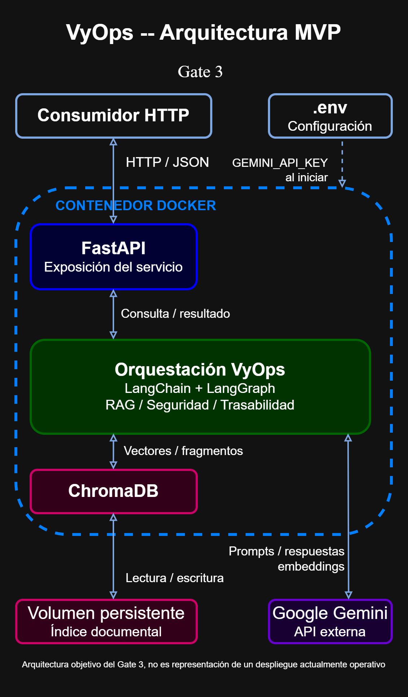

# VyOps — Agente de IA para Gestión Operativa

**Proyecto académico | Especialización en Desarrollo con IA Generativa — Accenture / SkillNest**

## 1. Descripción del proyecto

VyOps es un proyecto de agente de inteligencia artificial orientado a apoyar la gestión operativa de organizaciones y pequeñas y medianas empresas.

Su objetivo es permitir que los usuarios consulten información, obtengan respuestas contextualizadas y, progresivamente, puedan ejecutar tareas mediante herramientas e integraciones con APIs.

La arquitectura prevista es modular y multiempresa (*multi-tenant*), con separación de información por organización.

El proyecto se desarrolla de manera incremental durante el programa SkillNest.

## 2. Objetivo

Construir una solución capaz de:

- Interpretar solicitudes mediante lenguaje natural.
- Consumir modelos de inteligencia artificial mediante APIs.
- Procesar respuestas estructuradas.
- Validar datos y manejar errores.
- Evaluar modelos y prompts.
- Integrar fuentes documentales mediante RAG (implementado como prototipo en la Unidad 2).
- Incorporar herramientas, controles de acceso y observabilidad progresivamente.

Las capacidades que aún no están implementadas se incorporarán progresivamente en las siguientes unidades. El cierre vigente de la Unidad 2 se documenta al final de este README.

## 3. Evidencia histórica — Unidad 1 / Gate 1

La primera unidad incluye:

- Entorno virtual Python y dependencias reproducibles.
- Configuración segura de credenciales.
- Consumo funcional de Google Gemini mediante API REST.
- Procesamiento de respuestas y métricas de tokens.
- Manejo de errores HTTP y reintentos ante fallos transitorios.
- Evaluación comparativa de modelos.
- Banco de tres prompts con instrucciones de sistema.
- Validación de respuestas JSON estructuradas.
- Evaluación de consistencia con nueve ejecuciones.
- Documentación técnica y control de versiones.

**Modelo seleccionado para las pruebas actuales:** `gemini-3.5-flash-lite`.

## 4. Tecnologías

| Tecnología | Propósito |
|---|---|
| Python 3.13 | Lenguaje principal |
| Google Gemini API | Proveedor de inteligencia artificial |
| requests | Cliente HTTP |
| python-dotenv | Variables de entorno |
| google-genai | SDK de Gemini disponible en el entorno |
| tzdata | Soporte de zonas horarias |
| Git y GitHub | Control de versiones |
| Postman | Pruebas de API |
| venv | Aislamiento de dependencias |

## 5. Estructura inicial del repositorio (Unidad 1)

```text
vyops/
├── src/
│   ├── main.py
│   ├── cliente_api.py
│   ├── consumir_gemini.py
│   └── comparar_modelos.py
├── tests/
│   ├── test_cliente_gemini.py
│   └── test_cliente_modular.py
├── prompts/
│   ├── banco.py
│   ├── test_consistencia.py
│   ├── registro_resultados.json
│   ├── registro_resultados_anterior.json
│   └── registro_resultados_con_errores.json
├── resultados/
├── docs/
│   ├── evaluacion_modelos.md
│   ├── evaluacion_prompts.md
│   └── decision-arquitectura.md
├── .env.example
├── .gitignore
├── LICENSE
├── README.md
└── requirements.txt
```
Los archivos `.env` y `.venv/` son locales y no se incluyen en Git.

## 6. Instalación desde cero — Windows PowerShell

### 6.1. Requisitos previos

- Python 3.13 instalado.
- Git instalado.
- Conexión a internet.
- Clave API de Gemini obtenida desde Google AI Studio.

### 6.2. Clonar el repositorio

```powershell
git clone https://github.com/RDevAlarcon/vyops.git
cd vyops
```

### 6.3. Crear el entorno virtual

```powershell
python -m venv .venv
```

### 6.4. Activar el entorno virtual

```powershell
.\.venv\Scripts\Activate.ps1
```

### 6.5. Instalar dependencias

```powershell
python -m pip install -r requirements.txt
```

Verificar dependencias:

```powershell
python -m pip check
```

### 6.6. Configurar credenciales

Copiar la plantilla:

```powershell
Copy-Item .env.example .env
```

Abrir `.env` y reemplazar el valor de ejemplo por la clave API real:

```dotenv
GEMINI_API_KEY=
VYOPS_VECTORSTORE_DIR=vectorstore_profesor
```
VYOPS_VECTORSTORE_DIR define dónde se almacenará el índice ChromaDB generado localmente. El directorio vectorstore_profesor/ se encuentra excluido de Git. La configuración evita depender del índice original utilizado durante el desarrollo.

Nunca publicar la clave ni incluir `.env` en Git.

### 6.7. Preparar e indexar el corpus municipal

VyOps incluye 30 documentos municipales ficticios en el directorio `corpus/`, organizados por categorías.

Primero, verificar la preparación documental:

```powershell
python indexar_corpus.py
```

El resultado esperado es:

- 30 documentos originales.
- 387 fragmentos preparados.
- 387 identificadores únicos.
- 0 duplicados.

Este comando no genera embeddings ni realiza llamadas a Gemini.

Para construir el índice ChromaDB desde cero:

```powershell
python -m src.indexacion_incremental --directorio vectorstore_profesor
```

Esta operación utiliza Gemini para generar embeddings y puede consumir cuota de la API. El índice se almacena localmente en `vectorstore_profesor/`.

Para comprobar la instalación y ejecutar las pruebas automatizadas:

```powershell
python -m pytest -q
```

La indexación inicial e incremental se verificó previamente mediante pruebas locales aisladas con embeddings simulados. La reproducción completa desde un clon limpio utilizando Gemini se validó el 20 de noviembre de 2026; consultar la sección «Validación reproducible con Gemini real».

**Importante:** no utilizar `vectorstore/` como destino de indexación. Ese directorio corresponde al índice original del entorno de desarrollo y está protegido contra modificaciones por el módulo de indexación incremental.

### 6.8 — Ejecución y validación del servicio RAG

Requisitos previos: entorno virtual activo, dependencias instaladas, GEMINI_API_KEY configurada e índice vectorstore_profesor/ generado.
```powershell
python servicio_vyops_rag.py
```
Qué verifica: 387 fragmentos, recuperación documental, generación con citas, abstención segura, trazabilidad, protección contra inyección de prompts y supervisión humana simulada.

Resultado esperado: RESULTADO FINAL: SERVICIO RAG GATE 2 - PASS.

Advertencia: ejecuta dos consultas reales a Gemini y puede consumir cuota de API.

#### Control de solicitudes durante la indexación

La indexación reproducible utiliza `GoogleGenerativeAIEmbeddings`
con el modelo `models/gemini-embedding-001`.

Para reducir la frecuencia de solicitudes consecutivas a Gemini:

- Se procesan hasta 10 fragmentos por lote.
- Los lotes se procesan secuencialmente.
- Se aplica una pausa de 10 segundos entre lotes.
- No se aplica una pausa después del último lote.
- La pausa puede configurarse mediante
  `VYOPS_EMBEDDING_PAUSA_SEGUNDOS` en `.env`.
- Se conservan los fragmentos previamente indexados para evitar
  volver a generar embeddings innecesariamente.

La pausa predeterminada es de 10 segundos y admite valores
entre 0 y 300 segundos.

Para 387 fragmentos nuevos se estiman 39 lotes y 38 pausas,
equivalentes a 380 segundos de espera, además del tiempo
de procesamiento del proveedor.

Este mecanismo reduce la frecuencia de solicitudes, pero no
garantiza evitar los límites de cuota de Gemini.

Durante la indexación se utiliza `EmbeddingsConReintentos`, que
realiza hasta tres intentos ante errores HTTP 429, 500, 502 y 503,
con esperas progresivas de 2 y 4 segundos. Los errores 401 y 403
no se reintentan. Los reintentos se aplican a la generación de
embeddings, no a las escrituras de ChromaDB.

Este comportamiento se verificó mediante pruebas simuladas.
La integración real con Gemini se validó el 20 de noviembre de 2026. Los límites de cuota siguen dependiendo de la cuenta, el modelo y las condiciones del proveedor.

Las pruebas de este mecanismo utilizan dependencias simuladas
y no consumen la API de Gemini.

## 7. Ejecución del cliente inicial (Unidad 1)

Desde la raíz del proyecto, con el entorno virtual activado y `.env` configurado:

```powershell
python src/main.py
```

También es posible ejecutar directamente el módulo de consumo de Gemini:

```powershell
python src/consumir_gemini.py
```

### 7.1. Pruebas funcionales

El archivo `src/main.py` ejecuta tres pruebas.

**Prueba 1 — Consulta a Gemini**

Realiza una petición al modelo y muestra:

- Respuesta generada.
- Tokens utilizados.
- Tiempo de respuesta.
- Costo estimado de la consulta.

**Prueba 2 — Instrucción de sistema**

Envía una consulta utilizando `system_instruction` para configurar el comportamiento de Gemini como asistente de orientación municipal.

**Prueba 3 — Validación de entrada**

Envía una entrada inválida y comprueba que el sistema la rechace mediante una excepción `ValueError` controlada.

### 7.2. Resultado de verificación

El 22 de octubre de 2026 se ejecutó `src/main.py` correctamente.

| Prueba | Resultado |
|---|---|
| Consulta a Gemini | Correcta |
| Instrucción de sistema | Correcta |
| Validación de entrada | Correcta |

Las dos primeras pruebas requieren conexión a internet y disponibilidad de la API de Gemini. Consumen cuota del proveedor y pueden generar costos.

### 7.3. Otros componentes

Los módulos de evaluación comparativa de modelos y consistencia de prompts se mantienen independientes del punto de entrada principal.

Sus procedimientos de ejecución se describen en las siguientes secciones.

## 8. Evaluación de modelos

Se implementó una comparación de modelos de Gemini considerando:

- Respuestas correctas.
- Tiempo de respuesta.
- Consumo de tokens.
- Costo estimado.
- Errores de API.

Script:

```powershell
python src/comparar_modelos.py
```

Documentación:

- `docs/evaluacion_modelos.md`
- `docs/decision-arquitectura.md`

Los resultados históricos se conservan en `resultados/`.

## 9. Banco de prompts y validación JSON

El banco contiene tres prompts:

1. `clasificar_solicitud`
2. `extraer_datos_cliente`
3. `priorizar_solicitud`

Cada prompt define instrucciones de sistema, entrada de ejemplo, esquema JSON y claves obligatorias.

La evaluación se ejecuta mediante:

```powershell
python prompts/test_consistencia.py
```

Este comando realiza nueve consultas reales a Gemini y actualiza `prompts/registro_resultados.json`. Por lo tanto, consume cuota de API y puede generar costos.

**Resultado registrado el 20 de octubre de 2026:** 9 de 9 pruebas exitosas, con un 100 % de cumplimiento estructural para los ejemplos evaluados.

La evidencia histórica y el análisis se encuentran en:

- `prompts/registro_resultados.json`
- `prompts/registro_resultados_anterior.json`
- `prompts/registro_resultados_con_errores.json`
- `docs/evaluacion_prompts.md`

## 10. Seguridad y buenas prácticas

- Las credenciales se cargan desde `.env`.
- `.env` está excluido mediante `.gitignore`.
- `.env.example` contiene únicamente valores de ejemplo.
- Las dependencias se registran en `requirements.txt`.
- Las peticiones HTTP incorporan manejo de errores.
- Los errores transitorios pueden activar reintentos controlados.
- Las respuestas JSON se validan antes de procesarlas.
- El historial de cambios se mantiene en GitHub.

## 11. Evidencia técnica de la Unidad 1

### Primera petición autenticada

El 9 de octubre de 2026 se realizó una petición HTTP autenticada a Gemini mediante Postman.

- Modelo utilizado inicialmente: `gemini-2.5-flash`.
- Resultado HTTP: `200 OK`.
- Evidencia: [Primera petición autenticada](docs/evidencia_petición_autenticada.png).

Posteriormente se implementó el cliente Python y se evaluaron otros modelos para seleccionar una alternativa apropiada para VyOps.

### Arquitectura RAG

El diseño técnico y su evolución se documentan en `docs/`, incluyendo el diagrama de arquitectura y las decisiones de selección del modelo.
El diagrama de arquitectura de la Unidad 1 está disponible en:
[Diagrama de consumo de Gemini](docs/diagrama_consumo_gemini.png).

### Prueba funcional del cliente Python

El 20 de octubre de 2026 se comprobó la ejecución de `src/consumir_gemini.py`:

- Respuesta generada correctamente.
- 45 tokens totales.
- Tiempo de respuesta: 10,606 segundos.
- Costo estimado: USD 0,00008390.

## Unidad 2 — Bloque 12: Cliente de API modular

### Objetivo

Implementar una interfaz reutilizable para consultar la API de
Google Gemini, separando el consumo del modelo de la lógica
de las aplicaciones que utilizarán el cliente.

El módulo reutiliza las funciones desarrolladas durante Gate 1
y mantiene un manejo centralizado de errores y reintentos.

### Implementación

**Archivo principal:** `src/cliente_api.py`

La función pública `consultar_modelo()` coordina tres operaciones:

1. `armar_peticion()`: valida los parámetros y construye
   la solicitud HTTP.
2. `enviar_peticion()`: realiza la solicitud a Gemini,
   controla los errores y gestiona los reintentos.
3. `extraer_texto()`: obtiene el texto generado desde
   la respuesta JSON.

Las tres funciones reutilizadas se encuentran en
`src/consumir_gemini.py`.

### Ejecución del cliente

Desde la raíz del proyecto, con el entorno virtual activado
y la API key configurada:

```powershell
python -m src.cliente_api
```

Este comando ejecuta una consulta de demostración a Gemini
y muestra la respuesta o un error controlado en consola.

La consulta utiliza la API real, requiere conexión a internet
y puede consumir cuota o generar costos.

### Manejo de errores y reintentos

El cliente contempla:

- HTTP 400: solicitud rechazada, incluyendo posibles problemas
  con la API key o los parámetros enviados.
- HTTP 401 y 403: problemas de autenticación o acceso.
- HTTP 404: modelo o recurso no disponible.
- HTTP 429: límite de solicitudes.
- HTTP 500 y 502: errores temporales del proveedor.
- HTTP 503: servicio temporalmente no disponible.
- Timeout: tiempo de espera agotado.
- Errores de conexión y respuestas JSON inválidas.

Los errores HTTP 429, 500, 502 y 503, así como los timeout,
permiten hasta tres intentos en total.

Los reintentos utilizan pausas exponenciales de 2 y 4 segundos.
Cuando corresponde, se considera el encabezado `Retry-After`,
con un límite de espera de 60 segundos.

### Pruebas automatizadas

Los archivos de pruebas son:

- `tests/test_cliente_gemini.py`: validación de errores HTTP,
  timeout, reintentos y encabezado `Retry-After`.
- `tests/test_cliente_modular.py`: validación de la interfaz
  pública y propagación de errores.

Para ejecutar las pruebas desde la raíz del proyecto:

```powershell
python -m unittest discover -s tests -p "test_*.py" -v
```

**Resultado local del 23 de octubre de 2026:**

- 11 pruebas ejecutadas.
- 11 pruebas aprobadas.
- 0 errores.

Las pruebas automatizadas utilizan mocks y no realizan
solicitudes reales a Gemini.

### Alcance

Este bloque implementa un cliente modular reutilizable.
No incorpora todavía recuperación documental RAG,
herramientas externas ni funcionalidades multiempresa.

Estas capacidades se abordarán progresivamente
en las siguientes etapas del proyecto.

## Unidad 2 — Bloque 13: Reintentos avanzados y control de costos

### Objetivo

Mejorar la resiliencia del cliente Gemini y permitir el seguimiento
de costos estimados por operación y por sesión.

### Backoff exponencial con jitter

El cliente HTTP incorpora reintentos ante errores transitorios:

- HTTP 429, 500, 502 y 503.
- Timeout de la solicitud.
- Máximo de tres intentos en total.
- Esperas exponenciales de 2 y 4 segundos.
- Jitter aleatorio de hasta un 10 % de la espera base.
- Respeto del encabezado `Retry-After` como espera mínima.
- Límite configurado de 60 segundos para las esperas.

La implementación se encuentra en `src/consumir_gemini.py`.

### Cálculo de costos por operación

Se reutiliza la función `calcular_costo()` para estimar el costo
de cada respuesta a partir de los tokens informados por Gemini.

El modelo configurado es `gemini-3.5-flash-lite`.

Las tarifas configuradas son:

| Concepto | Precio por millón de tokens |
|---|---:|
| Entrada | USD 0,30 |
| Salida | USD 2,50 |

Los tokens de razonamiento se consideran dentro del cálculo
de salida, según la información de uso disponible.

Los costos son estimaciones y no reemplazan la facturación
oficial del proveedor.

### Registro de costos por sesión

El archivo `src/registro_costos.py` implementa
`RegistroCostosSesion`.

Permite:

- Registrar el costo estimado de cada operación exitosa.
- Consultar el historial de operaciones.
- Obtener el costo total acumulado.
- Mantener registros independientes entre instancias.
- Rechazar costos negativos, infinitos o inválidos.

El registro funciona en memoria. No incorpora persistencia
en base de datos ni recuperación después de reiniciar el proceso.

### Integración con el cliente modular

El archivo `src/cliente_api.py` incorpora
`consultar_modelo_con_costos()`.

Esta función consulta Gemini, extrae el texto, calcula el costo
estimado y lo registra en la sesión proporcionada.

La función original `consultar_modelo()` se mantiene disponible
sin cambios en su interfaz pública.

Los reintentos internos no generan registros adicionales por sí
mismos. El registro se realiza una vez después de procesar
correctamente la respuesta.

Si falla el envío, la extracción o el cálculo del costo,
no se registra una nueva operación.

Esto describe el registro local: una solicitud enviada al
proveedor podría consumir cuota o generar cargos incluso si
posteriormente falla su procesamiento.

### Pruebas automatizadas

Se utilizan los siguientes archivos:

- `tests/test_cliente_gemini.py`
- `tests/test_cliente_modular.py`
- `tests/test_registro_costos.py`

Para ejecutar todas las pruebas:

```powershell
python -m unittest discover -s tests -p "test_*.py" -v
```

**Resultado local del 24 de octubre de 2026:**

- 22 pruebas ejecutadas.
- 22 pruebas aprobadas.
- 0 errores.

Las pruebas utilizan simulaciones y no requieren llamadas
reales a Gemini.

## Unidad 2 — Bloque 14: Pruebas unitarias con pytest y mocks

### Objetivo

Validar el funcionamiento del cliente de Google Gemini mediante pruebas automatizadas, sin realizar solicitudes reales al proveedor.

Se utiliza `pytest` como ejecutor de pruebas, manteniendo la compatibilidad con las pruebas existentes desarrolladas con `unittest`.

### Escenarios verificados

- Respuestas HTTP 400, 401 y 403 sin reintentos.
- Reintentos ante errores HTTP 429, 500, 502 y 503.
- Agotamiento de reintentos y propagación de errores.
- Manejo de timeouts, espera exponencial, jitter y `Retry-After`.
- Ejecución de consultas mediante la API modular.
- Registro y acumulación de costos por sesión.
- Prevención del registro de costos cuando falla una consulta o su procesamiento.
- Validación de costos inválidos e independencia entre sesiones.
- Cálculo exacto del costo estimado a partir de tokens de entrada, salida y razonamiento.

### Archivos de pruebas

- `tests/test_cliente_gemini.py`
- `tests/test_cliente_modular.py`
- `tests/test_registro_costos.py`
- `tests/test_calculo_costos.py`

Las pruebas utilizan `unittest.mock` para simular respuestas y errores, evitando conexiones reales a Gemini.

### Ejecución

Con el entorno virtual activado:

```powershell
python -m pytest tests/ -v
```

### Resultados de validación

**Ejecución local del 25 de octubre de 2026:**

- 24 pruebas principales aprobadas.
- 5 subpruebas aprobadas.
- 0 errores.
- Tiempo de ejecución: 0,20 segundos.

La suite completa se ejecutó correctamente con Python 3.13.10 y pytest 9.1.1.

### Compatibilidad

Se conservan las pruebas existentes de `unittest`, ejecutables tanto con `unittest` como con `pytest`. No fue necesario reemplazar la arquitectura modular de VyOps.

## Unidad 2 — Bloque 15: Pipeline de texto y evaluación de respuestas

### Objetivo

Implementar un pipeline de procesamiento de texto para normalizar, tokenizar y vectorizar respuestas generadas por inteligencia artificial.

Evaluar la coincidencia de vocabulario entre respuestas de Google Gemini y textos de referencia, comparando los resultados antes y después de la normalización.

### Implementación

**Archivo principal:** `src/pipeline_texto.py`

Se implementaron cinco funciones:

- `limpiar_texto()`: convierte el texto a minúsculas, elimina signos de puntuación y normaliza espacios.
- `tokenizar()`: separa el texto en palabras, conservando su orden y repeticiones.
- `procesar_texto()`: integra las etapas de limpieza y tokenización.
- `vectorizar()`: utiliza `collections.Counter` para contar la frecuencia de las palabras.
- `calcular_coincidencia()`: calcula la proporción de palabras únicas de referencia presentes en una respuesta, con o sin normalización.

El pipeline utiliza únicamente componentes de la biblioteca estándar de Python.

### Evaluación de respuestas reales

**Script:** `evaluar_respuestas.py`

Se realizaron tres consultas reales a Gemini mediante la función `consultar_modelo()` del cliente modular existente.

Para cada consulta se comparó la respuesta generada con un texto de referencia.

**Resultados del 27 de octubre de 2026:**

| Caso | Sin normalización | Con normalización |
|---|---:|---:|
| Capital de Chile | 83,33 % | 100,00 % |
| Multiplicación de 5 por 4 | 50,00 % | 50,00 % |
| Función `print()` | 57,14 % | 85,71 % |
| **Promedio** | **63,49 %** | **78,57 %** |

La normalización aumentó la coincidencia promedio en aproximadamente 15,08 puntos porcentuales.

### Limitaciones de la métrica

La coincidencia de vocabulario no equivale a una evaluación de exactitud factual o similitud semántica.

Entre sus limitaciones:

- No reconoce automáticamente que `20` y `veinte` representan el mismo valor.
- No considera el orden de las palabras.
- No considera la frecuencia de las palabras repetidas.
- No penaliza directamente las palabras adicionales de una respuesta.
- Una coincidencia alta no garantiza que la información sea correcta.

Por lo tanto, esta métrica constituye una primera aproximación a la evaluación automática de respuestas.

### Ejecución de la evaluación

Desde la raíz del proyecto, con el entorno virtual activado y la clave API configurada:

```powershell
python evaluar_respuestas.py
```

Este comando realiza tres consultas reales a Gemini y puede consumir cuota de API o generar costos.

### Pruebas automatizadas

**Archivo:** `tests/test_pipeline_texto.py`

Se incorporaron nueve pruebas para validar:

- Limpieza de mayúsculas, puntuación y espacios.
- Tokenización y conservación de palabras repetidas.
- Integración del pipeline.
- Procesamiento de textos vacíos.
- Conteo de frecuencias.
- Vectorización de listas vacías.
- Comparación con y sin normalización.
- Manejo de referencias vacías.

Para ejecutar todas las pruebas del proyecto:

```powershell
python -m pytest tests/ -v
```

**Resultado local del 27 de octubre de 2026:**

- 33 pruebas principales aprobadas.
- 5 subpruebas aprobadas.
- 0 errores.
- Tiempo de ejecución: 0,21 segundos.

Las pruebas automatizadas no realizan consultas reales a Gemini.

### Alcance

Este bloque incorpora herramientas básicas de procesamiento y evaluación textual, reutilizando la arquitectura modular existente de VyOps.

No incluye todavía métricas semánticas avanzadas, embeddings ni evaluación mediante modelos jueces.

## Unidad 2 — Bloque 16: Métricas de precisión, cobertura y F1

### Objetivo

Implementar métricas cuantitativas para evaluar respuestas generadas por Google Gemini mediante comparación de tokens con textos de referencia.

Ampliar el pipeline desarrollado en el Bloque 15, incorporando precisión, cobertura (*recall*) y F1, con registro de resultados en formato JSON.

### Implementación

**Archivo principal:** `src/pipeline_texto.py`

Se incorporaron tres funciones:

- `contar_coincidencias()`: calcula las coincidencias entre tokens, considerando su frecuencia y evitando contabilizar repeticiones en exceso.
- `calcular_precision_cobertura_f1()`: calcula precisión, cobertura y F1 a partir de dos listas de tokens.
- `calcular_metricas()`: integra la normalización, tokenización y evaluación de dos textos.

Las métricas se calculan mediante las siguientes fórmulas:

**Precisión:**

`precision = coincidencias / tokens_respuesta`

**Cobertura:**

`cobertura = coincidencias / tokens_referencia`

**F1:**

`F1 = 2 × (precision × cobertura) / (precision + cobertura)`

Se contemplan casos de listas vacías y divisiones por cero.

### Evaluación automatizada de Gemini

**Script:** `evaluar_respuestas.py`

Se incorporaron las siguientes funciones:

- `evaluar_casos_bloque_16()`: consulta Gemini y calcula las métricas para cada caso.
- `guardar_resultados_metricas()`: guarda las evaluaciones en JSON.
- `resumir_metricas()`: calcula los promedios de las métricas.
- `obtener_peores_casos()`: identifica los casos con menor F1.
- `ejecutar_evaluacion_bloque_16()`: coordina la evaluación completa.

Para ejecutar exclusivamente el Bloque 16:

```powershell
python evaluar_respuestas.py --bloque-16
```

La evaluación original del Bloque 15 permanece disponible:

```powershell
python evaluar_respuestas.py
```

Ambos comandos realizan consultas reales a Gemini y pueden consumir cuota de API o generar costos.

### Resultados de la evaluación real

**Fecha:** 28 de octubre de 2026.

Se evaluaron tres consultas utilizando referencias breves.

| Consulta | Precisión | Cobertura | F1 |
|---|---:|---:|---:|
| ¿Qué es Python? | 2,06 % | 100,00 % | 4,03 % |
| ¿Cuándo se creó Python? | 10,00 % | 100,00 % | 18,18 % |
| ¿Qué es una lista en Python? | 1,95 % | 87,50 % | 3,81 % |
| **Promedio** | **4,67 %** | **95,83 %** | **8,68 %** |

Los resultados se almacenaron en:

`resultados/resultados_metricas.json`

### Interpretación de resultados

La cobertura promedio elevada indica que las respuestas de Gemini incluyeron la mayoría de los tokens presentes en los textos de referencia.

La precisión promedio fue baja porque las respuestas generadas contenían considerablemente más información que las referencias utilizadas.

En consecuencia, el F1 promedio de 8,68 % representa una coincidencia léxica limitada bajo esta metodología, no una calificación general de la calidad del modelo.

### Limitaciones identificadas

- Las métricas no evalúan directamente la exactitud factual.
- No identifican automáticamente sinónimos o expresiones semánticamente equivalentes.
- Pueden asignar valores elevados a respuestas que contienen datos incorrectos.
- No interpretan adecuadamente las negaciones.
- Las respuestas extensas pueden obtener una precisión baja frente a referencias breves.
- No detectan de manera fiable errores ortográficos o de redacción.

Estas limitaciones deberán considerarse al incorporar evaluaciones semánticas en etapas posteriores.

### Pruebas automatizadas

**Archivos:**

- `tests/test_pipeline_texto.py`
- `tests/test_evaluacion_bloque_16.py`

Se verificaron cálculos de métricas, palabras repetidas, textos vacíos, limitaciones semánticas, almacenamiento JSON, promedios, ordenamiento por F1 e integración completa sin llamadas reales a Gemini.

Para ejecutar todas las pruebas:

```powershell
python -m pytest tests/ -v
```

**Resultado local del 28 de octubre de 2026:**

- 46 pruebas principales aprobadas.
- 5 subpruebas aprobadas.
- 0 errores.
- Tiempo de ejecución: 0,33 segundos.

Las pruebas automatizadas utilizan simulaciones para evitar solicitudes reales a Gemini.

### Alcance

El Bloque 16 incorpora una evaluación cuantitativa reproducible basada en coincidencias léxicas y conserva los resultados obtenidos como evidencia técnica.

No incorpora todavía embeddings, métricas semánticas avanzadas ni evaluación mediante modelos jueces.


## Unidad 2 — Bloque 17: Interpretación cualitativa y límites del pipeline

En este bloque se evaluaron respuestas reales de Gemini para analizar las limitaciones de las métricas de precisión, cobertura y F1.

### Objetivos

- Evaluar al menos 20 respuestas generadas por un modelo de lenguaje.
- Comparar respuestas con referencias mediante métricas léxicas.
- Seleccionar casos con puntuaciones F1 altas y bajas.
- Realizar una revisión cualitativa de al menos 10 respuestas.
- Documentar las limitaciones de las métricas.

### Implementación

Se configuraron 23 casos de evaluación:

- 3 respuestas recuperadas del Bloque 16.
- 20 respuestas nuevas generadas durante el Bloque 17.

El sistema permite guardar los resultados progresivamente y reanudar las consultas pendientes sin repetir las ya registradas.

### Ejecución

Para ejecutar o reanudar la evaluación:

```powershell
python ejecutar_bloque_17.py
```

Para ejecutar las pruebas automatizadas:

```powershell
python -m pytest tests/ -v
```

### Resultados

Se revisaron cualitativamente 10 respuestas:

- 5 con los valores F1 más bajos.
- 5 con los valores F1 más altos.

La revisión mostró que algunas respuestas correctas y extensas obtuvieron puntuaciones F1 inferiores al 5 %.

Las respuestas matemáticas breves alcanzaron F1 del 100 % cuando coincidieron con las referencias.

Esto demuestra que una coincidencia léxica elevada no garantiza por sí sola la corrección factual y que un F1 bajo no implica necesariamente una respuesta incorrecta.

### Archivos principales

| Archivo | Descripción |
|---|---|
| `src/casos_evaluacion_bloque_17.py` | Banco de preguntas y referencias |
| `src/evaluacion_bloque_17.py` | Evaluación y selección de casos |
| `ejecutar_bloque_17.py` | Ejecución y reanudación |
| `tests/test_evaluacion_bloque_17.py` | Pruebas automatizadas |
| `resultados/resultados_bloque_17.json` | Respuestas y métricas |
| `resultados/revision_manual_bloque_17.json` | Evaluaciones cualitativas |
| `docs/limites_metrica.md` | Análisis de limitaciones |

### Conclusión

Las métricas de precisión, cobertura y F1 son útiles para comparar coincidencias textuales, pero deben complementarse con revisión humana cuando se necesita evaluar veracidad, significado o contradicciones.

## Unidad 2 — Bloque 18: LangChain y cadenas de tres etapas

En este bloque se implementó una cadena de procesamiento de texto utilizando LangChain y LangChain Expression Language (LCEL), integrando Gemini como modelo de lenguaje.

### Objetivos

- Comprender el uso de `PromptTemplate` para crear instrucciones parametrizadas.
- Conectar componentes mediante el operador `|`.
- Construir una cadena con tres etapas dependientes.
- Utilizar `StrOutputParser` para obtener respuestas en texto.
- Validar la cadena mediante modelos simulados y pruebas automatizadas.
- Ejecutar una prueba de integración real con Gemini.

### Implementación

Se desarrolló una cadena compuesta por tres etapas:

1. **Extracción:** identifica tres hallazgos principales de un informe.
2. **Simplificación:** transforma los hallazgos en explicaciones comprensibles.
3. **Formato:** presenta los resultados en tres viñetas Markdown.

Cada etapa recibe la salida de la anterior.

La función `construir_cadena(modelo)` permite inyectar un modelo real o simulado, facilitando las pruebas sin consumir cuota de la API.

### Ejecución

Para ejecutar la cadena con Gemini:

```powershell
python ejecutar_cadena_langchain.py
```

Se requiere configurar `GEMINI_API_KEY` mediante las variables de entorno o un archivo `.env` que no debe incorporarse a Git.

Para ejecutar las pruebas automatizadas:

```powershell
python -m pytest tests/ -v
```

### Resultados

Se validó la cadena mediante pruebas con `MagicMock`, `RunnableLambda` y `AIMessage`.

Las pruebas comprobaron que:

- El modelo se invoca tres veces.
- Cada etapa recibe correctamente la información de la anterior.
- La cadena devuelve el resultado esperado.

También se realizaron dos ejecuciones reales con Gemini, obteniendo tres viñetas Markdown que conservaron los datos originales del informe.

La batería completa de VyOps finalizó con **56 pruebas y 5 subpruebas aprobadas**, sin fallos.

### Limitaciones identificadas

El modelo `gemini-3.5-flash-lite` utiliza parámetros de muestreo fijos, por lo que la integración ignora el parámetro `temperature`.

Por este motivo, se eliminó `temperature=0` de la configuración de ejecución.

Las respuestas pueden presentar variaciones de redacción entre ejecuciones. Además, las pruebas con modelos simulados verifican la orquestación, pero no garantizan la exactitud factual de futuras respuestas reales.

### Archivos principales

| Archivo | Descripción |
|---|---|
| `src/plantillas_langchain.py` | Plantillas de extracción, simplificación y formato |
| `src/cadena_langchain.py` | Orquestación de las tres etapas mediante LCEL |
| `ejecutar_cadena_langchain.py` | Integración y ejecución real con Gemini |
| `tests/test_cadena_langchain.py` | Prueba automatizada de la cadena |
| `requirements.txt` | Dependencias de LangChain y del proyecto |

### Conclusión

LangChain permite construir flujos modulares en los que cada etapa tiene una responsabilidad definida. La separación entre plantillas, orquestación y modelo facilita las pruebas, el mantenimiento y la incorporación de nuevas etapas de procesamiento.

## Unidad 2 — Bloque 19: Enrutamiento condicional con LangChain

### Objetivo

Implementar un sistema capaz de clasificar mensajes y seleccionar automáticamente una cadena de respuesta según la intención detectada.

### Arquitectura

El sistema utiliza los siguientes componentes de LangChain:

- `PromptTemplate`: define las instrucciones de clasificación y respuesta.
- `StrOutputParser`: convierte las respuestas del modelo en texto.
- `RunnablePassthrough.assign`: conserva el mensaje original y agrega la categoría y la respuesta.
- `RunnableBranch`: selecciona la cadena correspondiente según la categoría.
- `Runnable`: permite inyectar modelos reales o simulados.

### Rutas disponibles

| Categoría | Comportamiento |
|---|---|
| `pregunta` | Responde consultas técnicas, administrativas y sobre procedimientos. |
| `queja` | Orienta sobre problemas, inconvenientes y posibles soluciones. |
| `sugerencia` | Analiza propuestas de mejora. |
| `defecto` | Gestiona mensajes cuya categoría no coincide con las anteriores. |

La clasificación se normaliza mediante `strip().lower()` para eliminar espacios exteriores y convertir el texto a minúsculas.

Si Gemini devuelve una categoría desconocida, se ejecuta la ruta por defecto y se conserva la categoría original normalizada.

### Estructura de salida

```python
{
    "mensaje": "Mensaje original",
    "categoria": "pregunta",
    "respuesta": "Respuesta generada por el modelo"
}
```

### Archivos principales

- `src/enrutamiento_langchain.py`: clasificación, plantillas, rutas y cadena de enrutamiento.
- `ejecutar_enrutamiento.py`: integración real con Gemini.
- `tests/test_enrutamiento_langchain.py`: pruebas unitarias con modelos simulados.

### Ejecución

```powershell
python ejecutar_enrutamiento.py
```

Requiere configurar `GEMINI_API_KEY` en el entorno.

### Pruebas

```powershell
python -m pytest tests/test_enrutamiento_langchain.py -v
```

Resultado: 5 pruebas aprobadas.

Suite completa:

```powershell
python -m pytest -v
```

Resultado: 61 pruebas y 5 subpruebas aprobadas.

### Consideraciones

- Cada mensaje requiere normalmente dos llamadas al modelo: clasificación y respuesta.
- Las pruebas unitarias utilizan modelos simulados para evitar consumo de API.
- La clasificación depende de la respuesta generada por Gemini.
- La ruta por defecto gestiona categorías desconocidas, pero no sustituye el manejo de errores de ejecución.
- La información sobre trámites, permisos y normativas debe verificarse mediante fuentes oficiales actualizadas.
- El sistema no dispone todavía de herramientas para consultar fuentes oficiales en tiempo real.

## Unidad 2 — Bloque 20: Manejo de errores en cadenas LangChain

Se implementaron mecanismos de recuperación ante errores para mejorar la robustez del enrutamiento condicional desarrollado en el Bloque 19.

### Funcionalidades implementadas

- `with_fallbacks()`: activa una respuesta alternativa cuando falla la cadena principal.
- `try/except`: captura excepciones durante la ejecución.
- `logging`: registra errores técnicos para facilitar su diagnóstico.
- Recuperación ante errores de clasificación y generación de respuestas.
- Conservación del mensaje original y devolución de respuestas seguras.

### Pruebas automatizadas

El material de SkillNest utiliza `test_orquestacion.py` como ejemplo de pruebas de orquestación. En VyOps, estas verificaciones se organizan por funcionalidad, principalmente en `tests/test_manejo_errores_langchain.py`.

Ejecutar las pruebas del Bloque 20:

```powershell
python -m pytest tests/test_manejo_errores_langchain.py -v
```

Resultado verificado: **9 pruebas aprobadas**.

Ejecutar la suite completa:

```powershell
python -m pytest -v
```

Resultado verificado: **70 pruebas aprobadas y 5 subpruebas aprobadas**.

Las pruebas utilizan modelos simulados y no requieren llamadas reales a la API de Gemini.

**Nota:** Las pruebas de VyOps cubren los mecanismos implementados en este bloque. No se afirma una equivalencia exacta con los casos de `test_orquestacion.py` del curso.


## Unidad 2 — Bloque 21: Agente municipal con herramientas

Se implementó un agente inteligente para VyOps, orientado al apoyo de la gestión municipal en Chile mediante LangChain, Gemini y herramientas especializadas.

El agente puede seleccionar herramientas según la solicitud del usuario, realizar cálculos, analizar indicadores y consultar documentación local.

### Herramientas implementadas

- `calcular_metricas`: calcula suma, promedio, máximo y mínimo sobre una lista de valores numéricos.
- `analizar_datos`: compara dos valores, calcula variaciones absolutas y porcentuales e identifica tendencias.
- `consultar_documentacion`: consulta información interna disponible sobre VyOps, LangChain y agentes.

La documentación consultada es local y estática. No existe todavía una conexión con documentos o sistemas municipales reales.

### Arquitectura del agente

Se utilizan los componentes de LangChain:

- `ChatPromptTemplate`: define las instrucciones del asistente municipal.
- `MessagesPlaceholder`: incorpora el historial de ejecución de herramientas.
- `create_tool_calling_agent`: construye el agente con capacidad de invocar herramientas.
- `AgentExecutor`: administra la ejecución y conserva la trazabilidad mediante `intermediate_steps`.
- `ChatGoogleGenerativeAI`: proporciona acceso a los modelos Gemini.
- `with_fallbacks()`: configura un modelo de respaldo ante excepciones del modelo principal.

El agente utiliza un máximo de cinco iteraciones y configura un límite de ejecución de 60 segundos.

Este límite no garantiza la interrupción inmediata de llamadas externas bloqueadas.

### Manejo seguro de errores

Se implementó `ejecutar_agente_seguro()` para controlar errores de ejecución.

El sistema contempla:

- Errores de conexión.
- Excepciones de tiempo de espera.
- Errores inesperados.
- Detección del mensaje de detención por límite de iteraciones.
- Registro técnico mediante `logging`.
- Respuestas de error comprensibles en español.

La detección del límite de iteraciones depende actualmente del mensaje específico devuelto por LangChain.

Los registros técnicos deben protegerse porque pueden incluir detalles de las excepciones.

### Normalización de respuestas

La función `normalizar_respuesta_agente()` convierte las respuestas del agente a texto plano.

Permite procesar respuestas que llegan como cadenas de texto o listas de bloques, excluyendo metadatos internos del contenido visible.

La ejecución segura conserva la trazabilidad de las herramientas utilizadas.

### Archivos principales

- `src/agente_con_herramientas.py`: herramientas, configuración del agente, ejecución segura y normalización.
- `tests/test_agente_con_herramientas.py`: pruebas automatizadas del agente.
- `requirements.txt`: dependencias necesarias para el funcionamiento del proyecto.

### Pruebas automatizadas

Ejecutar las pruebas del Bloque 21:

```powershell
python -m pytest tests/test_agente_con_herramientas.py -v
```

Resultado verificado: **23 pruebas aprobadas**.

Ejecutar la suite completa:

```powershell
python -m pytest -v
```

Resultado verificado: **93 pruebas aprobadas y 5 subpruebas aprobadas**.

Las pruebas automatizadas utilizan modelos simulados y no requieren llamadas reales a Gemini.

Adicionalmente, se realizaron pruebas manuales de integración con Gemini para verificar la selección de herramientas y la ejecución de cálculos.

### Consideraciones y limitaciones

- El agente es un prototipo de aprendizaje y no constituye un sistema municipal en producción.
- No dispone de acceso a expedientes, bases de datos municipales ni sistemas institucionales.
- No consulta normativa oficial actualizada en tiempo real.
- El modelo de respaldo se activa ante excepciones, no por la calidad de las respuestas.
- Las pruebas automatizadas no garantizan el comportamiento de todos los modelos reales.
- Las respuestas generadas deben verificarse antes de utilizarse en decisiones administrativas.
- Las futuras integraciones deberán incorporar controles de acceso, protección de datos y auditoría.

## Unidad 2 — Bloque 22: Herramienta personalizada y memoria conversacional

Se amplió el agente municipal VyOps con una herramienta estructurada y memoria conversacional por sesión.

### Herramienta personalizada

Se implementó `consultar_estado_solicitud` utilizando `@tool` y un esquema Pydantic (`ArgumentosConsultaSolicitud`).

Permite:
- Consultar el estado de solicitudes municipales simuladas.
- Recuperar opcionalmente el historial de estados.
- Validar automáticamente los argumentos recibidos.
- Responder cuando una solicitud no existe en los datos de prueba.

La herramienta se integró al agente municipal junto con las tres herramientas del Bloque 21.

### Memoria conversacional

Se implementó memoria temporal mediante `InMemoryChatMessageHistory` y `RunnableWithMessageHistory`.

Características:
- Historial independiente por identificador de sesión.
- Recuperación de mensajes anteriores.
- Eliminación de historiales.
- Integración con `AgentExecutor`.
- Compatibilidad con consultas sin memoria.

La información permanece únicamente en memoria RAM y no persiste entre reinicios del proceso.

### Verificación

La suite completa finalizó con **106 pruebas aprobadas, 5 subpruebas aprobadas y 0 fallos**.

Las pruebas del agente y su memoria utilizaron modelos simulados, sin llamadas reales a Gemini.

### Limitaciones y mejoras pendientes

- Las solicitudes municipales son datos ficticios.
- El aislamiento por sesión no reemplaza los mecanismos de autenticación y autorización.
- La memoria no es persistente.
- `InMemoryChatMessageHistory` y `RunnableWithMessageHistory` generan advertencias de obsolescencia. Se planifica migrar a la persistencia de LangGraph antes de su eliminación en versiones futuras.

## Unidad 2 — Bloque 23: Memoria de contexto y límites de autonomía

VyOps incorpora mecanismos de supervisión humana, clasificación de riesgos y auditoría para controlar las acciones del agente municipal.

### Clasificación de riesgos

Las herramientas se clasifican en tres niveles:

- **Bajo:** consultas de solo lectura. Ejecución autónoma.
- **Medio:** modificaciones reversibles. Requieren controles adicionales.
- **Alto:** operaciones irreversibles o de impacto económico. Requieren aprobación humana explícita.

Las herramientas desconocidas permanecen restringidas hasta su clasificación. Actualmente no existen herramientas operativas de riesgo medio.

### Supervisión humana de operaciones

Se incorporó la herramienta `cancelar_solicitud_simulada`, que permite demostrar operaciones de alto riesgo bajo supervisión humana.

El agente solicita ejecutar la operación y el supervisor presenta una pregunta en PowerShell:

```text
--- SUPERVISIÓN HUMANA ---
Operación: cancelación ficticia de SOL-12345
¿Autorizar esta operación? (s/n):
```

El operador decide:

- **`s`:** autoriza la cancelación ficticia.
- **`n`:** rechaza la operación, que permanece bloqueada.

Las autorizaciones están vinculadas a una herramienta y solicitud específicas, tienen vigencia limitada y se consumen una sola vez.

La herramienta solo está disponible cuando se configura un supervisor externo al agente. El agente no controla directamente los identificadores de autorización.

**Importante:** la autorización interactiva fue validada con una persona operando PowerShell, pero todavía no existe autenticación de identidad del supervisor. La cancelación es exclusivamente simulada y no modifica solicitudes municipales reales.

### Auditoría y trazabilidad

El módulo `src/trazas_agente.py` permite:

- Registrar ejecuciones en formato JSONL.
- Conservar fecha UTC e identificador de sesión.
- Registrar entradas, herramientas y argumentos.
- Registrar observaciones y respuestas finales.
- Detectar tres o más llamadas consecutivas a una misma herramienta dentro de una ejecución.

Las trazas se generan explícitamente desde los scripts de validación. Todavía no existe registro automático de todas las ejecuciones del agente.

### Evidencias del Bloque 23

**1. Evidencia sintética**

Archivo: `evidencias/trazas_bloque_23.jsonl`

Contiene dos escenarios ficticios construidos para comprobar el formato de auditoría:

1. Consulta municipal de bajo riesgo.
2. Cancelación ficticia de alto riesgo bloqueada.

Para generar esta evidencia desde cero:

```powershell
python -m scripts.generar_evidencia_auditoria
```

El generador impide sobrescribir un archivo existente.

**2. Ejecuciones con Gemini y autorizaciones programadas**

Archivo: `evidencias/trazas_gemini_bloque_23.jsonl`

Contiene tres escenarios ejecutados con Gemini:

1. Consulta de bajo riesgo.
2. Cancelación ficticia rechazada.
3. Cancelación ficticia aprobada.

En estos escenarios, las decisiones de autorización fueron programadas.

**3. Ejecuciones con Gemini y supervisión humana interactiva**

Archivo: `evidencias/trazas_gemini_manual_bloque_23.jsonl`

Contiene tres escenarios ejecutados con Gemini:

1. Consulta de bajo riesgo sin autorización.
2. Cancelación ficticia rechazada manualmente mediante `n`.
3. Cancelación ficticia aprobada manualmente mediante `s`.

En ambos escenarios de riesgo alto, el supervisor solicitó una decisión al operador desde PowerShell.

Para ejecutar la validación interactiva:

```powershell
python -m scripts.validar_gemini_bloque_23
```

**Nota:** el script requiere configurar el acceso a Gemini y utiliza un archivo de evidencia que no debe existir previamente, porque evita sobrescribir registros. Las trazas conservan los efectos de las decisiones, pero no registran explícitamente la identidad del operador ni la respuesta introducida.

### Pruebas automatizadas

Para ejecutar todas las pruebas:

```powershell
python -m pytest -q
```

Última validación del Bloque 23:

- **158 pruebas aprobadas.**
- **5 subpruebas aprobadas.**
- **0 fallos.**
- **4 advertencias de deprecación de LangChain.**

Las pruebas automatizadas utilizan modelos simulados. Adicionalmente, se realizaron pruebas de integración con Gemini y supervisión humana interactiva.

### Limitaciones conocidas

El prototipo todavía presenta las siguientes limitaciones:

- No existe autenticación real del supervisor humano.
- Las autorizaciones no cuentan con persistencia segura.
- El timeout de autorización no garantiza interrumpir un `input()` que permanece esperando en otro hilo.
- Las trazas no incluyen anonimización automática de información sensible.
- La detección de patrones sospechosos es limitada.
- No existe monitoreo continuo ni alertas automáticas.

Estas limitaciones deben resolverse antes de utilizar el sistema en un entorno municipal real.

### Documentación técnica

Consultar [`docs/limites_autonomia_agente.md`](docs/limites_autonomia_agente.md).

Incluye clasificación de riesgos, supervisión humana, auditoría, frecuencia propuesta de revisión, patrones sospechosos, respuesta ante incidentes y limitaciones pendientes.

**Estado:** Bloque 23 implementado y validado como prototipo educativo. No apto todavía para operar sobre datos municipales reales.


## Unidad 2 — Bloque 24: RAG: chunking, embeddings y ChromaDB

Se implementó la primera etapa de recuperación documental
de VyOps mediante la preparación e indexación de un corpus
municipal ficticio. **Los resultados de esta sección son históricos:**
la implementación vigente se describe en el cierre del Gate 2.

### Corpus documental

El corpus inicial contenía cinco documentos
breves relacionados con:

- Registro de solicitudes municipales.
- Estados de solicitudes.
- Consulta mediante identificadores.
- Supervisión humana de cancelaciones.
- Auditoría de decisiones del asistente.

Los documentos son ficticios y se utilizan exclusivamente
con fines educativos.

### Estrategias de chunking

El script `scripts/comparar_chunking.py` permite comparar:

- `CharacterTextSplitter`: división por caracteres.
- `RecursiveCharacterTextSplitter`: división que prioriza
  los límites naturales del texto.

En el ejercicio original se utilizaron:

- `chunk_size=200`
- `chunk_overlap=30`

El corpus inicial generó cinco chunks, uno por documento.
La configuración vigente es `chunk_size=800` y `chunk_overlap=120`.

### Embeddings y almacenamiento vectorial

La indexación histórica utilizó:

- `GoogleGenerativeAIEmbeddings`
- Modelo `models/gemini-embedding-001`
- `ChromaDB` mediante `langchain-chroma`

Los embeddings persistentes se almacenan localmente en `vectorstore/`.

Esta carpeta está excluida de Git mediante `.gitignore`.

### Ejecución

Con el entorno virtual activo, la versión vigente permite preparar
los documentos sin necesidad de llamar a Gemini:

```powershell
python indexar_corpus.py
```

**Comportamiento vigente:** `indexar_corpus.py` solo carga, valida
y fragmenta documentos. No genera embeddings ni escribe en ChromaDB.
Las evidencias de indexación real que se enumeran a continuación
corresponden a la ejecución histórica del Bloque 24.

### Validación

Durante el ejercicio original se verificó:

- Preparación de cinco documentos y cinco chunks.
- Generación de embeddings mediante Gemini.
- Almacenamiento de cinco registros en ChromaDB.
- Recuperación de los cinco registros desde otro proceso,
  sin volver a indexar.
- Ejecución de la suite completa de pruebas.

Resultado de las pruebas:

- **158 pruebas aprobadas.**
- **5 subpruebas aprobadas.**
- **0 fallos.**
- **4 advertencias de deprecación de LangChain.**

### Limitaciones

En ese momento constituía una etapa inicial de RAG.
La recuperación y la generación fundamentada se incorporaron
en bloques posteriores; consultar el cierre vigente del Gate 2.

No utiliza documentos municipales oficiales ni datos reales.

## Unidad 2 — Bloque 25: Réplica guiada de indexación y persistencia

### Objetivo

Reproducir el proceso de indexación vectorial aprendido en el Bloque 24 utilizando un corpus independiente, verificando la integridad de los fragmentos, la generación de embeddings y la persistencia de los datos en ChromaDB.

### Implementación

Se creó el archivo `practicas/bloque_25/replica_ejemplo.py`, que implementa:

1. Un corpus de cinco documentos ficticios sobre pedidos, devoluciones y reembolsos.
2. División mediante `RecursiveCharacterTextSplitter`, configurado con `chunk_size=150` y `chunk_overlap=20`.
3. Validación de fragmentos vacíos, duplicados y conservación del contenido.
4. Generación de embeddings con `models/gemini-embedding-001`.
5. Almacenamiento persistente en ChromaDB, utilizando la colección `corpus_ejemplo`.
6. Comprobación de registros existentes para evitar una nueva indexación accidental.

### Ejecución

Desde la raíz del proyecto, con el entorno virtual activo:

```powershell
python practicas/bloque_25/replica_ejemplo.py
```

La ejecución requiere la variable `GEMINI_API_KEY` configurada en el archivo `.env` para generar nuevos embeddings.

### Resultados obtenidos

| Validación | Resultado |
|---|---|
| Documentos originales | 5 |
| Chunks generados | 5 |
| Chunks vacíos | 0 |
| Chunks duplicados | 0 |
| Caracteres originales | 490 |
| Caracteres en los chunks | 490 |
| Registros almacenados en ChromaDB | 5 |

### Verificación de persistencia

Se comprobó que los registros permanecen disponibles desde un proceso independiente de Python:

```powershell
python -c "from langchain_chroma import Chroma; db = Chroma(collection_name='corpus_ejemplo', persist_directory='vectorstore_ejemplo'); print('Registros recuperados:', db._collection.count())"
```

Resultado:

```text
Registros recuperados: 5
```

### Consideraciones

- La base vectorial se almacena en `vectorstore_ejemplo/`.
- El directorio está excluido del control de versiones mediante `.gitignore`.
- La base municipal del Bloque 24, ubicada en `vectorstore/`, permanece independiente.
- Este ejercicio valida indexación y persistencia; todavía no implementa recuperación semántica ni generación de respuestas mediante RAG.

## Unidad 2 — Bloque 26: Recuperación semántica y prompt dinámico

Se implementó un flujo RAG (Retrieval-Augmented Generation)
para responder preguntas sobre un corpus municipal ficticio.

### Funcionamiento

1. Recibe una pregunta del usuario.
2. Genera su embedding mediante Gemini.
3. Recupera los 3 documentos más similares desde ChromaDB.
4. Construye un prompt dinámico con contenido y fuentes.
5. Genera una respuesta mediante Gemini.
6. Comprueba que las citas numéricas correspondan a documentos recuperados.

### Archivo principal

`recuperacion.py`

Funciones implementadas:

- `recuperar_documentos()`: búsqueda semántica.
- `construir_contexto()`: contexto numerado con fuentes.
- `construir_prompt()`: instrucciones para responder con evidencia.
- `generar_respuesta()`: generación mediante Gemini.
- `validar_citas()`: comprobación de numeración de citas.

### Pruebas realizadas

- Consulta sobre cancelación: respuesta correcta con cita [1].
- Consulta sobre identificador: recuperación del documento pertinente.
- Consulta sobre horarios: abstención por falta de información.
- Validación automática: citas válidas, inexistentes y ausencia de citas.

### Limitaciones

- Las citas se validan por numeración, no por respaldo semántico automático.
- ChromaDB puede recuperar documentos aunque no respondan la pregunta.
- El corpus y las fuentes son ficticios.
- Las etiquetas `.md` de las fuentes son identificadores lógicos;
  no representan necesariamente archivos físicos.

### Ejecución

```powershell
python recuperacion.py
python -m pytest -q
```

### Resultado de pruebas

161 pruebas aprobadas, 5 subtests aprobados y
4 advertencias conocidas de LangChain.


## Unidad 2 — Bloque 27: Evaluación de recuperación RAG

**Evaluación histórica del Bloque 27:** se evaluó la recuperación
semántica de VyOps con un corpus municipal ficticio de cinco documentos.
La evaluación actualizada con 30 documentos aparece en el cierre del Gate 2.

### Metodología

- Motor vectorial: ChromaDB.
- Embeddings: Gemini (`models/gemini-embedding-001`).
- Casos evaluados: 5 preguntas.
- Documentos relevantes: definidos previamente.
- Configuraciones comparadas: k=1, k=3 y k=5.
- Métricas: precisión@k, recall@k y F1.

### Resultados

| k | Precisión media | Recall medio | F1 medio |
|---|---|---|---|
| 1 | 1.000 | 1.000 | 1.000 |
| 3 | 0.333 | 1.000 | 0.500 |
| 5 | 0.200 | 1.000 | 0.333 |

### Conclusión

En los cinco casos evaluados, el documento relevante
apareció en primera posición.

La configuración k=1 obtuvo el mejor F1 para este
conjunto de evaluación.

Estos resultados no garantizan el mismo comportamiento
con corpus más grandes o preguntas que requieran
combinar varios documentos.

### Archivos

- `metricas_recuperacion.py`: cálculo de métricas.
- `conjunto_evaluacion.py`: preguntas y relevancia esperada.
- `evaluar_recuperacion.py`: evaluación real con ChromaDB.
- `resultados_evaluacion.txt`: resultados registrados.
- `tests/test_metricas_recuperacion.py`: pruebas unitarias.

### Validación

Suite completa: 167 pruebas aprobadas.

```powershell
python -m pytest -q
```

## Unidad 2 — Bloque 28: Observabilidad del sistema RAG

Este bloque incorpora medición de rendimiento, seguimiento del consumo de tokens, estimación de costos y persistencia de métricas para el sistema RAG municipal de VyOps.

### Funcionalidades implementadas

- **Medición de latencia:** registro de tiempos de recuperación documental, construcción del prompt, generación de respuestas, conteo de tokens de embedding y validación de citas.
- **Consumo de tokens:** extracción de tokens de entrada, salida y total desde los metadatos de Gemini.
- **Tokens de razonamiento y caché:** conservación de los valores informados por el proveedor, diferenciando los datos no disponibles de los valores cero.
- **Costos estimados:** cálculo del costo de generación y embedding utilizando tarifas configurables.
- **Persistencia JSONL:** almacenamiento local de las métricas de cada ejecución registrada.
- **Protección de registros:** exclusión de `resultados_rag.jsonl` mediante `.gitignore`.

### Archivos principales

| Archivo | Responsabilidad |
|---|---|
| `latencia_rag.py` | Medición de tiempos por etapa |
| `configuracion_modelos.py` | Configuración de modelos y tarifas |
| `costos_rag.py` | Estimación de costos |
| `tokens_embedding.py` | Conteo de tokens de embedding |
| `registro_rag.py` | Integración de métricas con el flujo RAG |
| `persistencia_rag.py` | Almacenamiento de registros JSONL |
| `tests/test_persistencia_rag.py` | Prueba automatizada de persistencia |

### Ejecutar el sistema RAG con métricas

Desde la raíz del proyecto, con el entorno virtual activado y las credenciales de Gemini configuradas:

```powershell
python registro_rag.py
```

La ejecución muestra la respuesta generada, las fuentes utilizadas, la validación de citas, los tiempos, los tokens consumidos y los costos estimados.

También guarda un registro en:

```text
resultados_rag.jsonl
```

Este archivo se mantiene local y no se incorpora al repositorio.

### Ejecutar las pruebas automatizadas

```powershell
python -m pytest tests/ -v
```

**Última validación del Bloque 28:**

- 168 pruebas aprobadas.
- 5 subtests aprobados.
- 0 fallos.
- 4 advertencias de deprecación relacionadas con componentes de memoria de LangChain.

### Resultado de referencia

En una ejecución real con `gemini-3.5-flash-lite` se obtuvieron:

| Métrica | Resultado |
|---|---|
| Latencia RAG | 4,47 segundos |
| Latencia completa | 6,12 segundos |
| Tokens de generación | 227 |
| Tokens de embedding contabilizados | 12 |
| Costo total estimado | US$0,0001073 |
| Validación de numeración de citas | Correcta |

Estos valores corresponden a una ejecución de referencia y pueden variar entre consultas.

Los costos son estimaciones basadas en las tarifas configuradas.

### Consideraciones técnicas

- El conteo de tokens de embedding realiza una consulta adicional al proveedor.
- La validación de citas comprueba la numeración, pero no garantiza que el contenido generado esté respaldado semánticamente por los documentos.
- Los registros JSONL se escriben cuando se ejecuta `registro_rag.py` como programa principal.
- Las tarifas deben revisarse cuando cambien los precios del proveedor.
- La migración de las API de memoria obsoletas de LangChain queda pendiente como mejora futura.

## Unidad 2 — Bloque 29: Laboratorio de personalización de modelos

### Objetivo

Preparar un dataset para personalización de modelos y estudiar las estrategias RAG, fine-tuning, PEFT y soft-prompting.

En VyOps se utiliza como caso práctico la clasificación de solicitudes municipales mediante salidas JSON estructuradas.

### Dataset de entrenamiento

Archivo principal: `dataset_tuning.py`

Se construyeron 12 ejemplos ficticios distribuidos equitativamente entre cuatro intenciones:

| Intención | Ejemplos |
|---|---:|
| `consulta_estado` | 3 |
| `nueva_solicitud` | 3 |
| `cancelacion` | 3 |
| `reclamo` | 3 |

Cada ejemplo contiene un texto de entrada y una salida JSON con los campos `intencion` y `prioridad`.

Las prioridades permitidas son `baja`, `media` y `alta`.

### Validación del dataset

Se implementaron funciones para:

- Analizar el balance de las categorías.
- Detectar entradas y salidas vacías.
- Identificar entradas duplicadas.
- Detectar JSON inválido.
- Comprobar campos obligatorios.
- Rechazar intenciones y prioridades no permitidas.

El dataset original superó la validación con **0 problemas**.

La prueba negativa detectó correctamente cuatro errores introducidos intencionalmente.

### Seguimiento de trabajos de tuning

Se implementó `esperar_a_que_termine()` para consultar periódicamente el estado de un trabajo de tuning.

Se verificó mediante pruebas simuladas el comportamiento ante los estados:

- `RUNNING`
- `SUCCEEDED`
- `FAILED`
- `CANCELLED`
- `PARTIALLY_SUCCEEDED`

No se ejecutó un entrenamiento real. El seguimiento se validó sin llamadas a la API de Gemini.

### Ejecutar el laboratorio

```powershell
python dataset_tuning.py
```

### Ejecutar las pruebas

Pruebas específicas:

```powershell
python -m pytest tests/test_dataset_tuning.py -v
```

Batería completa:

```powershell
python -m pytest tests/ -v
```

**Resultado de validación:** 181 pruebas aprobadas, 5 subtests aprobados y 4 advertencias de deprecación de LangChain.

### Consideraciones

- El dataset es ficticio y tiene fines educativos.
- Clasificar una solicitud de cancelación no autoriza su ejecución; VyOps mantiene la aprobación humana para operaciones sensibles.
- La preparación del dataset no equivale a entrenar un modelo.
- El entrenamiento PEFT real queda sujeto a disponibilidad técnica, compatibilidad del modelo y evaluación de costos.

## Unidad 2 — Bloque 30: Decisión fundamentada de personalización

En este bloque se compararon tres estrategias de personalización
de modelos de lenguaje: RAG, fine-tuning completo y PEFT.

### 1. Estimación de costos

Se implementó `costos_personalizacion.py` para estimar el tiempo
y costo de etiquetar ejemplos de entrenamiento.

Escenario educativo:
- 500 ejemplos, 4 minutos por ejemplo y USD 20 por hora.
- Etiquetado inicial: 33,33 horas y USD 666,67.
- Segunda revisión del 20 %: 3,33 horas y USD 66,67.
- Total estimado: 36,67 horas y USD 733,33.

Estos valores son supuestos del ejercicio, no gastos reales de VyOps.

### 2. Comparación de estrategias

Se implementó `comparar_estrategias.py`, que utiliza cinco criterios:

1. Frecuencia de actualización de la información.
2. Necesidad de mejorar formato o tono.
3. Disponibilidad de un dataset grande y de calidad.
4. Limitaciones de presupuesto o necesidad de iterar rápidamente.
5. Necesidad de múltiples variantes del modelo.

El algoritmo calcula puntuaciones, identifica empates y permite
realizar análisis de sensibilidad.

### 3. Decisión para VyOps

La estrategia seleccionada es RAG.

Resultados:
- RAG: 5 puntos.
- PEFT: 1 punto.
- Fine-tuning completo: 0 puntos.

La elección responde a la prioridad de entregar información
municipal actualizada, verificable y respaldada por fuentes.

Las respuestas del método representan una evaluación inicial
del proyecto y deberán revisarse con evidencia operativa.

### 4. Análisis de sensibilidad

Al cambiar el criterio de información cambiante de verdadero
a falso, las puntuaciones fueron:

- RAG: 2 puntos.
- PEFT: 1 punto.
- Fine-tuning completo: 0 puntos.

RAG continúa siendo la estrategia recomendada, aunque su
ventaja disminuye.

### 5. Documento de decisión

El archivo `decision_personalizacion.md` contiene:

1. Definición del problema.
2. Resultados del método de decisión.
3. Justificación de la estrategia seleccionada.
4. Recursos necesarios para ejecutarla.

El documento se generó inicialmente mediante
`generar_esqueleto_decision()` y posteriormente se completó
con la justificación y el plan de implementación.

### 6. Pruebas automatizadas

Se incorporaron ocho pruebas con pytest:

- `tests/test_comparar_estrategias.py`: 4 pruebas.
- `tests/test_costos_personalizacion.py`: 4 pruebas.

Resultado de la batería completa:

- 189 pruebas aprobadas.
- 5 subtests aprobados.
- 4 advertencias de deprecacion de LangChain.
- Sin pruebas fallidas.

Para ejecutar las pruebas:

```powershell
python -m pytest -q
```

## Unidad 2 — Bloque 31: Logging estructurado y mitigación de inyección de prompt

En este bloque se incorporaron mecanismos de observabilidad, trazabilidad y seguridad al sistema RAG de VyOps.

El objetivo es reconstruir el procesamiento de una consulta mediante registros estructurados, detectar instrucciones sospechosas en documentos recuperados y evitar que estos documentos lleguen al modelo de generación.

### 1. Logging estructurado en JSON

Se implementó `logs_json.py`, que utiliza un formateador personalizado para generar registros JSON.

Los registros incluyen:

- Fecha y hora del evento.
- Nivel del registro.
- Mensaje y tipo de evento.
- Identificador de trazabilidad (`trace_id`).
- Metadatos relevantes para la ejecución.

El sistema evita registrar preguntas completas y contenido íntegro de documentos sospechosos.

### 2. Trazabilidad de consultas

Se implementó `traza_contexto.py`, utilizando `ContextVar` y UUID para generar identificadores únicos.

Cada consulta mantiene el mismo `trace_id` durante sus diferentes etapas.

El contexto de trazabilidad se restablece al finalizar la ejecución, incluso cuando se produce una excepción.

### 3. Huellas digitales y callbacks

Se desarrollaron dos ejercicios complementarios:

- `huellas_documentos.py`: generación de huellas SHA-256 abreviadas para identificar documentos.
- `callbacks_trazas.py`: demostración de callbacks de LangChain para observar eventos de recuperación y generación.

Estos componentes se implementaron como ejercicios de observabilidad y no sustituyen el registro principal del pipeline RAG.

### 4. Registro de consumo de Gemini

Se incorporó `registrar_consumo()` en `registro_rag.py`.

Esta función registra:

- `input_tokens`.
- `output_tokens`.
- `total_tokens`.

Los eventos de consumo quedan asociados al `trace_id` de la consulta.

También se mantienen las métricas de latencia, estimación de costos y validación de citas.

### 5. Detección y mitigación de inyección de prompt

Se implementó `inyeccion_prompt.py`, que identifica patrones sospechosos en documentos recuperados.

Entre los patrones evaluados se encuentran:

- Instrucciones para ignorar reglas anteriores.
- Intentos de modificar el comportamiento del asistente.
- Referencias a nuevos prompts de sistema.
- Solicitudes para revelar instrucciones internas.

Los documentos sospechosos se descartan antes de construir el prompt.

Los eventos de seguridad registran el índice del documento, la cantidad de patrones detectados y el identificador de trazabilidad, sin almacenar el contenido completo del ataque.

También se incorporó una función para separar documentos aceptados y descartados.

Si todos los documentos recuperados son rechazados, el sistema bloquea la generación de la respuesta.

**Limitación:** el filtrado mediante expresiones regulares es una primera medida de protección y no garantiza detectar todas las variantes de inyección de prompt.

### 6. Protección del prompt RAG

Se reforzó `construir_prompt()` en `recuperacion.py`.

El prompt establece que los documentos recuperados contienen información no confiable y que sus instrucciones no deben modificar las reglas del asistente.

También se incorporaron delimitadores para distinguir el contexto documental de las instrucciones principales.

Se conservaron las reglas de generación basada en evidencia, citas verificables y prohibición de ejecutar acciones municipales.

### 7. Demostración de trazabilidad

Se implementó `demo_trazabilidad.py`.

La demostración procesa dos documentos simulados:

1. Un documento legítimo.
2. Un documento que contiene una inyección de prompt.

Resultados observados:

- Una consulta recibida.
- Dos documentos procesados.
- Un documento aceptado.
- Un documento descartado.
- Tres patrones sospechosos detectados.
- Un mismo `trace_id` en los eventos registrados.

Para ejecutar la demostración:

```powershell
python demo_trazabilidad.py
```

### 8. Integración con el RAG real

Se integraron los mecanismos de observabilidad y seguridad en `registro_rag.py`.

El flujo comprende:

1. Generación del identificador de consulta.
2. Recuperación de documentos.
3. Filtrado de seguridad.
4. Construcción del prompt.
5. Generación de respuesta mediante Gemini.
6. Registro de consumo, latencia y costos.
7. Validación de citas.

Se realizaron dos ejecuciones reales con `gemini-3.5-flash-lite`.

En la segunda ejecución se obtuvieron:

- Documentos recuperados: 3.
- Documentos aceptados: 3.
- Documentos descartados: 0.
- Tokens de entrada: 295.
- Tokens de salida: 17.
- Tokens totales: 312.
- Tiempo completo: 9,73 segundos.
- Costo estimado: USD 0,0001328.
- Citas inválidas: 0.

Los seis eventos de la consulta compartieron el mismo `trace_id`.

La prueba real verificó la integración del filtro, pero no produjo descartes porque los documentos recuperados fueron aceptados. El bloqueo de documentos maliciosos se validó mediante pruebas automatizadas.

Para ejecutar el RAG real:

```powershell
python registro_rag.py
```

Esta operación requiere la configuración local correspondiente y puede consumir tokens de la API de Gemini.

### 9. Pruebas automatizadas

Se incorporaron y actualizaron pruebas para verificar:

- Generación y propagación de `trace_id`.
- Formato JSON de los registros.
- Detección de variantes de inyección.
- Descarte de documentos sospechosos.
- Separación de documentos aceptados y descartados.
- Bloqueo de generación sin documentos seguros.
- Registro de consumo del modelo.
- Persistencia de métricas sin registrar preguntas completas.

Resultado de la batería completa:

- 204 pruebas aprobadas.
- 11 subpruebas aprobadas.
- 4 advertencias de deprecación de LangChain.
- Sin pruebas fallidas.

Para ejecutar las pruebas:

```powershell
python -m pytest -q
```

Las advertencias corresponden a componentes de memoria de LangChain utilizados en ejercicios anteriores y no impiden la ejecución del proyecto.


## Unidad 2 — Bloque 32: Versionado de prompts y supervisión humana

Se implementaron mecanismos de control de versiones de prompts,
supervisión humana de cambios y evaluación de riesgos para VyOps.

El objetivo es mejorar la trazabilidad y evitar la activación
de nuevas versiones de prompts sin autorización.

### 1. Registro y versionado de prompts

Archivo: `registro_prompts.py`

Se registraron dos versiones reales del prompt RAG:

- **V1:** prompt municipal original con citas, commit `7c3c204`.
- **V2:** prompt reforzado contra inyección, commit `04706ff`.

El registro incluye:

- Identificador de versión y commit.
- Autor y fecha UTC de registro.
- Descripción del cambio.
- Huella SHA-256 del contenido.
- Modelo utilizado y parámetros configurados.
- Comparación de versiones mediante `difflib`.

La clase `RegistroDePrompts` permite registrar versiones,
impedir duplicados y consultar la última versión.

Las huellas identifican el contenido del prompt extraído
del código histórico y permiten detectar modificaciones.

Ejecutar:

```powershell
python registro_prompts.py
```

### 2. Supervisión humana con LangGraph

Archivo: `grafo_supervision.py`

Se implementó un flujo de tres etapas:

1. `proponer`: presenta la versión candidata.
2. `supervisar`: interrumpe la ejecución para solicitar una decisión.
3. `aplicar`: procesa la aprobación o el rechazo.

Se utilizan:

- `StateGraph` para definir el flujo.
- `interrupt()` para detener la ejecución.
- `Command(resume=True)` para aprobar.
- `Command(resume=False)` para rechazar.
- `InMemorySaver` para conservar el estado temporal.

La demostración comprueba ambos escenarios:
aprobación y rechazo, utilizando identificadores
de ejecución independientes.

Ejecutar:

```powershell
python grafo_supervision.py
```

**Limitación:** es una simulación educativa. No modifica
la configuración real de VyOps ni incorpora autenticación
del supervisor o persistencia duradera de las aprobaciones.

### 3. Matriz de riesgos

Archivo: `matriz_riesgos.py`

Se documentaron cinco riesgos asociados a VyOps:

1. Inyección de prompt en documentos recuperados.
2. Exposición de datos personales en logs.
3. Respuestas municipales sin respaldo documental.
4. Documentos municipales desactualizados.
5. Cambios de prompt sin aprobación humana.

Cada riesgo incluye probabilidad, impacto,
puntaje, categoría, mitigación, detección de
casos límite y necesidad de supervisión humana.

El puntaje se calcula mediante:

**Riesgo = Probabilidad × Impacto**

Las categorías utilizadas son:

| Puntaje | Categoría |
|---|---|
| 15 a 25 | CRÍTICO |
| 9 a 14 | ALTO |
| 4 a 8 | MEDIO |
| 1 a 3 | BAJO |

La función `esta_en_el_limite()` comprueba si
una variación de un punto en probabilidad o impacto
puede modificar la categoría asignada.

Resultados:

- 2 riesgos críticos.
- 2 riesgos altos.
- 1 riesgo medio.
- 5 riesgos identificados como casos límite.

La salida incluye una vista detallada y una
tabla comparativa mediante `tabulate`.

Ejecutar:

```powershell
python matriz_riesgos.py
```

### 4. Pruebas automatizadas

Se incorporaron 22 pruebas nuevas:

| Archivo | Pruebas |
|---|---:|
| `tests/test_registro_prompts.py` | 5 |
| `tests/test_grafo_supervision.py` | 3 |
| `tests/test_matriz_riesgos.py` | 14 |
| **Total** | **22** |

Ejecutar las pruebas específicas:

```powershell
python -m pytest tests/test_registro_prompts.py tests/test_grafo_supervision.py tests/test_matriz_riesgos.py -q
```

Ejecutar la suite completa:

```powershell
python -m pytest -q
```

**Resultado verificado:**

- 226 pruebas aprobadas.
- 11 subpruebas aprobadas.
- 4 advertencias conocidas de LangChain.
- 0 pruebas fallidas.
- Tiempo total: 3,70 segundos.

### 5. Consideraciones y trabajo pendiente

- El versionado registra los prompts, pero no constituye
  todavía un sistema de despliegue automatizado.
- La supervisión humana se demuestra mediante decisiones
  programadas, no mediante una interfaz autenticada.
- `InMemorySaver` no ofrece persistencia entre reinicios.
- Las puntuaciones de riesgo son estimaciones iniciales
  del ejercicio y requieren revisión periódica.
- Los controles de seguridad implementados no garantizan
  la eliminación de todos los riesgos.

**Estado:** Bloque 32 implementado y validado
como prototipo educativo.

## Cierre de Unidad 2 — Gate 2

**Proyecto:** VyOps — Asistente de IA para Gestión Operativa
**Caso de uso:** Consultas documentales de la Municipalidad ficticia de Valle Claro
**Estado:** PASS técnico local&#x20;

### Cumplimiento de los requisitos del Gate 2

| Requisito de SkillNest               | Implementación y evidencia                                                                                                                                    |
| ------------------------------------ | ------------------------------------------------------------------------------------------------------------------------------------------------------------- |
| 1. Indexación y recuperación         | Pipeline incremental con Gemini y ChromaDB. Índice persistente de 387 fragmentos, sincronización idempotente y protección contra modificaciones accidentales. |
| 2. Recuperación y métricas           | Recuperación documental con fuentes y citas. Evaluación de precisión, recall y F1 sobre cinco preguntas del corpus propio, con k=1, 3 y 5.                    |
| 3. Costos y latencia                 | Instrumentación de tokens, costos y tiempos de ejecución. Validación real con Gemini: 2.412 tokens y costo estimado de USD 0,00083105.                        |
| 4. Personalización                   | Evaluación de estrategias RAG, fine-tuning y PEFT mediante una matriz de decisión aplicada al caso municipal.                                                 |
| 5. Logging y consumo                 | Registros JSON estructurados, sanitizados y correlacionados mediante `trace_id`, incluyendo consumo por consulta.                                             |
| 6. Seguridad contra prompt injection | Filtrado aplicado a documentos recuperados. Prueba de bloqueo con documento sospechoso y sin invocación del LLM.                                              |
| 7. Versionado y supervisión humana   | Registro de versiones de prompts y demostración con LangGraph utilizando `interrupt()` y `Command(resume=...)`.                                               |
| 8. Matriz de riesgos                 | Cinco riesgos documentados: dos críticos, dos altos y uno medio, con medidas de mitigación y supervisión.                                                     |
| 9. Reproducibilidad                  | Instalación, indexación, pruebas y ejecución del servicio RAG verificadas desde un clon limpio de GitHub.                                                     |

### Validación final

**Fecha:** 20 de noviembre de 2026
**Commit validado:** `54f46b5`

- 30 documentos municipales ficticios y 387 fragmentos indexados.
- 252 pruebas y 11 subpruebas aprobadas.
- Dos consultas reales a Gemini: respuesta con tres citas válidas y abstención segura.
- Trazabilidad, seguridad y supervisión humana simulada verificadas.

**Resultado de ejecución:**

```text
RESULTADO FINAL: SERVICIO RAG GATE 2 - PASS
```

## Guía de ejecución — Gate 2

Para instalar VyOps desde cero, construir el índice vectorial
y ejecutar la demostración de Gate 2, consultar:

[Guía de instalación y ejecución de Gate 2](README_GATE2.md)

## Módulo 3 — Construcción, despliegue y validación del MVP

El Módulo 3 tiene como objetivo transformar los componentes
desarrollados durante los módulos anteriores en un servicio
funcional, reproducible, documentado y evaluable.

VyOps mantiene como caso de uso académico las consultas
documentales de la Municipalidad ficticia de Valle Claro.

La construcción del MVP considera la reutilización del sistema
RAG validado durante el Gate 2, incorporando progresivamente
FastAPI, Docker, pruebas de calidad, seguridad y documentación
técnica para la entrega del Gate 3.

## Unidad 3.1 — Bloque 33: Diseño funcional y arquitectura de la solución

### 1. Objetivo

Definir el problema de negocio, los requerimientos funcionales
y no funcionales, el alcance del MVP, el presupuesto de
construcción y la arquitectura objetivo de VyOps.

El diseño busca garantizar que el proyecto sea viable dentro
del tiempo disponible, evitando incorporar funcionalidades
que excedan el alcance académico.

### 2. Problema de negocio

Los funcionarios administrativos municipales requieren consultar
documentos, normativas y procedimientos internos para resolver
dudas relacionadas con sus actividades diarias.

La búsqueda manual de información en documentos dispersos
genera demoras, aumenta la carga administrativa y dificulta
la entrega de respuestas consistentes.

Escenario simulado:

- 50 consultas documentales semanales.
- 10 minutos estimados por consulta.
- 8 horas y 20 minutos de trabajo semanal.
- Objetivo: reducir el tiempo promedio de consulta a un
  minuto o menos.

Estos valores corresponden a supuestos del ejercicio académico
y no representan mediciones realizadas en una municipalidad real.

### 3. Requerimientos funcionales

| ID | Requerimiento | Prioridad |
|---|---|---|
| RF-01 | Consultas mediante API HTTP y respuestas JSON | Imprescindible |
| RF-02 | Recuperación documental con fuentes y citas | Imprescindible |
| RF-03 | Abstención ante evidencia insuficiente | Imprescindible |
| RF-04 | Detección y bloqueo de intentos de inyección de prompts | Imprescindible |
| RF-05 | Trazabilidad mediante `trace_id` | Imprescindible |
| RF-06 | Supervisión humana simulada mediante API | Deseable |
| RF-07 | Panel gráfico de métricas operacionales | Deseable |
| RF-08 | Interfaz web con autenticación | Fuera de alcance |
| RF-09 | Integración con sistemas municipales reales | Fuera de alcance |
| RF-10 | Gestión multiempresa | Fuera de alcance |

Las funcionalidades deseables se incorporarán únicamente
cuando exista disponibilidad de tiempo y se hayan satisfecho
los requisitos imprescindibles.

### 4. Requerimientos no funcionales

| ID | Criterio objetivo |
|---|---|
| RNF-01 | Al menos 9 de 10 consultas respondidas en menos de 30 segundos |
| RNF-02 | Cero exposiciones de información sensible en 10 pruebas de seguridad y privacidad |
| RNF-03 | Inicio del servicio mediante Docker en un máximo de 15 minutos, con imagen e índice previamente preparados |
| RNF-04 | Al menos 9 de 10 consultas con evidencia disponible respaldadas por fuentes pertinentes y verificables |
| RNF-05 | El 100 % de 10 consultas independientes con identificadores de trazabilidad únicos |

Los criterios anteriores representan objetivos de aceptación
del MVP y todavía no constituyen resultados certificados.

### 5. Presupuesto de construcción

Se desarrolló un ejercicio de planificación utilizando
exclusivamente la biblioteca estándar de Python.

La disponibilidad estimada corresponde a 20 días de trabajo,
con una dedicación de tres horas diarias.

| Concepto | Horas |
|---|---:|
| Disponibilidad total | 60 |
| Reserva para pruebas, documentación y defensa técnica (30 %) | 18 |
| Margen para imprevistos (20 %) | 12 |
| Presupuesto neto de construcción | 30 |
| Requisitos imprescindibles | 15 |
| Requisitos deseables seleccionados | 10 |
| Total seleccionado | 25 |
| Holgura de construcción | 5 |

Se aplica un factor de novedad tecnológica de 1,5 a las
funcionalidades identificadas como nuevas.

Las capas obligatorias del MVP son:

- API.
- RAG.
- Contenedor.

La selección conserva los requisitos imprescindibles para
detectar explícitamente los escenarios en los que el MVP
no resulta viable dentro del presupuesto disponible.

### 6. Funcionalidades excluidas

| ID | Horas ajustadas | Motivo |
|---|---:|---|
| RF-08 | 8 | Fuera del alcance académico |
| RF-09 | 15 | Integración con sistemas reales |
| RF-10 | 12 | Fuera del alcance académico |
| **Total** | **35** | |

El informe diferencia las exclusiones por restricciones
académicas, integración con sistemas reales y falta de
presupuesto.

Se verificó la conciliación entre las horas solicitadas,
seleccionadas y excluidas.

### 7. Escenarios alternativos

| Escenario | Presupuesto neto | Horas seleccionadas | Resultado |
|---|---:|---:|---|
| Disponibilidad de 60 horas | 30 | 25 | PASS |
| Sin contenedor | 30 | 21 | FAIL esperado |
| Disponibilidad de 40 horas | 20 | 19 | PASS |
| Disponibilidad de 30 horas | 15 | 15 | PASS |
| Disponibilidad de 20 horas | 10 | 15 | FAIL esperado |

La variante sin contenedor detecta la ausencia de una capa
obligatoria y del requerimiento RNF-03.

El escenario de 20 horas detecta un exceso de cinco horas
sobre el presupuesto neto de construcción.

Los resultados FAIL corresponden a pruebas negativas
intencionales y demuestran el funcionamiento de las
validaciones.

Las horas corresponden a estimaciones de planificación,
no a tiempos reales de implementación.

### 8. Arquitectura de la solución

Se definieron cinco decisiones principales de arquitectura:

| Componente | Tecnología | Responsabilidad |
|---|---|---|
| Modelo generativo | Google Gemini | Generación de respuestas y embeddings mediante su API |
| Almacenamiento vectorial | ChromaDB | Persistencia y recuperación documental |
| Orquestación | LangChain + LangGraph | Coordinación de los flujos de procesamiento |
| Exposición del servicio | FastAPI | Comunicación mediante API HTTP y JSON |
| Empaquetado | Docker | Ejecución reproducible del servicio |

La arquitectura contempla un volumen persistente para
conservar el índice documental independientemente del
ciclo de vida del contenedor.

Las credenciales se proporcionarán mediante variables
de entorno, utilizando un archivo `.env` externo.

Google Gemini permanecerá como servicio externo al
contenedor Docker.

### Diagrama de arquitectura



[Archivo editable del diagrama de arquitectura](docs/diagrama_arquitectura.drawio)

El diagrama representa la arquitectura objetivo del Gate 3
y no un despliegue actualmente operativo.

La arquitectura mantiene una separación modular de
responsabilidades que facilitará su evolución futura
hacia una plataforma multiempresa.

La gestión multiempresa no forma parte del MVP académico.

### 9. Generador de ficha funcional

Archivo: `crear_ficha.py`

Se implementó un generador que permite:

- Crear automáticamente la estructura de la ficha funcional.
- Crear el directorio de documentación cuando no existe.
- Utilizar codificación UTF-8.
- Evitar la sobrescritura de documentos existentes.
- Conservar las cinco secciones definidas para el diseño.

Se verificó que una segunda ejecución no modifica una
ficha previamente creada mediante la comparación de
sus hashes.

### 10. Verificador de ficha funcional

Archivo: `verificar_ficha.py`

Se implementaron validaciones para comprobar:

- Existencia de las cinco secciones obligatorias.
- Títulos y numeración de las secciones.
- Contenido completo de las secciones 1 a 3.
- Ausencia de marcadores pendientes en las secciones evaluadas.
- Cantidad mínima de requerimientos funcionales y no funcionales.
- Identificadores duplicados.
- Presencia de valores numéricos en los requisitos no funcionales.
- Clasificación de todos los requerimientos funcionales.
- Máximo de cinco requisitos funcionales imprescindibles.
- Existencia de los archivos de imagen referenciados.
- Presencia de términos tecnológicos en el problema de negocio.

El verificador admite clasificaciones de alcance distribuidas
en varias líneas.

Devuelve un código de salida 0 cuando no existen errores
y un código de salida 1 cuando se detectan incumplimientos.

La revisión automática se complementa con una revisión
manual del contenido y del diagrama de arquitectura.

### 11. Archivos principales

| Archivo | Responsabilidad |
|---|---|
| `practicas/bloque_33/presupuesto_alcance.py` | Planificación y validación del presupuesto |
| `practicas/bloque_33/variante_sin_contenedor.py` | Validación de ausencia de una capa obligatoria |
| `practicas/bloque_33/variante_horas.py` | Evaluación de escenarios de disponibilidad |
| `crear_ficha.py` | Generación de la ficha funcional |
| `verificar_ficha.py` | Validación automática de la ficha |
| `docs/ficha_diseno_funcional.md` | Documento de diseño funcional |
| `docs/diagrama_arquitectura.png` | Diagrama de arquitectura objetivo |
| `docs/diagrama_arquitectura.drawio` | Archivo editable del diagrama |

El diagrama histórico del consumo de Gemini se conserva
en `docs/diagrama_consumo_gemini.png`.

### 12. Ejecución

Desde la raíz del proyecto, con el entorno virtual activo.

Ejecutar el ejercicio de presupuesto:

```powershell
python practicas/bloque_33/presupuesto_alcance.py
```

Evaluar la ausencia del contenedor:

```powershell
python practicas/bloque_33/variante_sin_contenedor.py
```

Evaluar escenarios alternativos de disponibilidad:

```powershell
python practicas/bloque_33/variante_horas.py
```

Generar la estructura de la ficha funcional:

```powershell
python crear_ficha.py
```

El generador no sobrescribe la ficha existente.

Validar la ficha funcional:

```powershell
python verificar_ficha.py
```

Los scripts del Bloque 33 no requieren llamadas a Gemini
ni dependencias externas adicionales.

### 13. Resultados de validación

Fecha: 24 de noviembre de 2026.

| Validación | Resultado |
|---|---|
| Presupuesto de construcción | PASS |
| Escenarios alternativos | PASS |
| Informe de funcionalidades excluidas | PASS |
| Conciliación de horas | PASS |
| Generador de ficha funcional | PASS |
| Protección contra sobrescritura | PASS |
| Verificador de ficha funcional | PASS |
| Integridad y formatos de diagramas | PASS |
| Secciones 1 a 3 de la ficha | PASS |
| Conservación de secciones 4 y 5 pendientes | PASS |

Resultado del verificador:

```text
=== VERIFICACION DE FICHA FUNCIONAL ===

Errores: 0
Avisos: 0
Ficha verificada: secciones 1 a 3 completas
RESULTADO: PASS
```

### 14. Pruebas de regresión

Se ejecutaron las pruebas descubiertas mediante `unittest`
para comprobar el comportamiento de los componentes
desarrollados durante los módulos anteriores.

```powershell
python -m unittest discover -s tests -p "test_*.py" -v
```

Resultados:

- 65 pruebas aprobadas.
- 0 errores.
- 0 fallos.
- Tiempo de ejecución: 0,203 segundos.
- Código de salida: 0.

Esta ejecución corresponde a la suite descubierta mediante
`unittest` y no sustituye los resultados históricos de la
suite completa ejecutada mediante `pytest`.

#### Validación de la suite completa mediante pytest

```powershell
python -m pytest -q
```

Resultados:

- 252 pruebas aprobadas.
- 11 subpruebas aprobadas.
- 0 pruebas fallidas.
- Tiempo de ejecución: 4,32 segundos.
- Código de salida: 0.

La suite completa conserva los resultados obtenidos durante
el cierre del Gate 2, sin regresiones detectadas tras la
incorporación de los entregables del Bloque 33.

### 15. Documentación técnica

Consultar la
[Ficha de Diseño Funcional](docs/ficha_diseno_funcional.md).

El documento contiene:

1. Problema de negocio.
2. Requerimientos y alcance del MVP.
3. Arquitectura de la solución.
4. Criterios de aceptación (pendiente del Bloque 34).
5. Plan de construcción por hitos (pendiente del Bloque 34).

### 16. Limitaciones y trabajo pendiente

- FastAPI y Docker corresponden a componentes planificados
  para las siguientes etapas de construcción.
- Los objetivos de rendimiento y calidad documental
  requieren validación mediante pruebas específicas.
- La supervisión humana mediante API y el panel gráfico
  de métricas son funcionalidades deseables.
- La autenticación real y la gestión multiempresa quedan
  fuera del alcance académico.
- No se utilizan datos municipales reales.
- Los controles de seguridad existentes no garantizan
  protección contra todas las variantes de ataques.

**Estado:** Bloque 33 completado y validado técnicamente
en entorno local.

**Siguiente etapa:** Bloque 34 — Criterios de aceptación
y plan de construcción por hitos.

## Unidad 3.1 — Bloque 34: Criterios de aceptación y plan de construcción por hitos

### 1. Objetivo

Completar la ficha de diseño funcional de VyOps mediante
criterios de aceptación verificables, un plan de construcción
por hitos y una revisión crítica del alcance del MVP.

El bloque establece las condiciones que deberán cumplirse
durante la construcción, integración y validación del Gate 3,
manteniendo la coherencia con las decisiones de arquitectura
y alcance adoptadas durante el Bloque 33.

### 2. Criterios de aceptación ejecutables

Se desarrolló un ejercicio práctico para demostrar cómo
los requerimientos pueden transformarse en comprobaciones
observables y ejecutables.

El ejercicio incluye:

- Validación de la estructura de una respuesta JSON.
- Comprobación de respuestas respaldadas por fuentes.
- Abstención ante ausencia de información.
- Evaluación de tiempos de respuesta.
- Ejecución independiente de cada criterio.
- Registro de resultados satisfactorios y fallidos.

El ejercicio utiliza respuestas simuladas y no requiere
llamadas a Google Gemini.

#### Escenario correcto

```powershell
python practicas/bloque_34/criterios_demo.py
```

Resultado:

| Criterio | Resultado |
|---|---|
| CA-01 | PASS |
| CA-02 | PASS |
| CA-03 | PASS |
| CA-05 | PASS |
| Total | 4/4 |

#### Variante defectuosa

```powershell
python practicas/bloque_34/variante_rota.py
```

La variante elimina intencionalmente el campo `fuentes`
de la respuesta simulada.

| Criterio | Resultado |
|---|---|
| CA-01 | FAIL esperado |
| CA-02 | FAIL esperado |
| CA-03 | FAIL esperado |
| CA-05 | PASS |
| Total | 1/4 |

Los incumplimientos son intencionales y demuestran que
los criterios permiten detectar respuestas defectuosas.

El ejercicio restaura el comportamiento original después
de ejecutar la variante.

### 3. Extracción estructurada de la ficha funcional

Se implementó el módulo `ficha_datos.py` para extraer
información estructurada desde la ficha de diseño funcional.

El módulo permite identificar:

- Requerimientos funcionales.
- Requerimientos no funcionales.
- Clasificación del alcance.
- Criterios de aceptación.
- Hitos de construcción.
- Horas disponibles.
- Margen de imprevistos.

La implementación reutiliza las funciones de extracción
desarrolladas durante el Bloque 33, evitando duplicar
la lógica existente.

La extracción de información se mantiene separada
de los procesos de validación.

### 4. Resumen automático de la ficha

Se implementó `resumen_ficha.py` para facilitar
la revisión objetiva del alcance y la planificación.

El resumen informa:

- Cantidad de requerimientos funcionales y no funcionales.
- Distribución de funcionalidades según su alcance.
- Cantidad de criterios de aceptación.
- Requerimientos obligatorios sin cobertura.
- Cantidad de hitos y horas planificadas.
- Disponibilidad y margen de imprevistos.
- Criterios huérfanos.
- Hitos sin criterios asociados.

Ejecución:

```powershell
python resumen_ficha.py
```

El resumen tiene carácter informativo y no sustituye
al verificador completo.

### 5. Verificador completo de la ficha funcional

Se implementó `verificar_ficha_completa.py` para ampliar
las comprobaciones desarrolladas durante el Bloque 33.

El verificador realiza las siguientes validaciones:

#### Estructura y alcance

- Existencia de las cinco secciones obligatorias.
- Coherencia de los títulos.
- Requerimientos funcionales y no funcionales.
- Clasificación de funcionalidades.
- Existencia del diagrama de arquitectura.
- Ausencia de secciones pendientes de completar.

#### Criterios de aceptación

- Formato de los identificadores.
- Ausencia de identificadores duplicados.
- Referencias a requerimientos existentes.
- Cobertura de los requerimientos obligatorios.
- Identificación de criterios que requieren mayor precisión.

#### Planificación por hitos

- Existencia de entre tres y seis hitos.
- Identificadores únicos.
- Horas de construcción positivas.
- Referencias a requerimientos y criterios existentes.
- Coherencia entre requerimientos y criterios de cada hito.
- Cobertura de los requerimientos imprescindibles.
- Ausencia de criterios huérfanos.
- Cumplimiento del presupuesto disponible.

#### Revisión del alcance

- Existencia del documento de revisión.
- Presencia de al menos dos hallazgos.
- Identificadores de hallazgos no duplicados.
- Correspondencia entre hallazgos y decisiones.
- Utilización de decisiones reconocidas.

El verificador devuelve un código de salida 0 cuando
no existen errores y un código de salida 1 cuando
se detectan incumplimientos.

Las comprobaciones estructurales no sustituyen
la evaluación manual de la calidad del diseño.

### 6. Validación mediante escenarios controlados

Se utilizó una ficha funcional independiente para comprobar
la capacidad de los scripts de detectar inconsistencias.

Los escenarios evaluados incluyeron:

| Escenario | Resultado esperado |
|---|---|
| Secciones pendientes | FAIL |
| Diagrama inexistente | FAIL |
| Requerimiento obligatorio sin criterio | FAIL |
| Presupuesto excedido | FAIL |
| Hito sin criterio asociado | FAIL |
| Criterio huérfano | FAIL |
| Documento de revisión inexistente | FAIL |
| Ficha corregida y revisión válida | PASS |

La ficha temporal de práctica no forma parte de los
entregables definitivos de VyOps.

### 7. Criterios de aceptación de VyOps

Se completó la sección 4 de la ficha de diseño funcional
con diez criterios de aceptación.

| Criterio | Requerimiento | Comprobación |
|---|---|---|
| CA-01 | RF-01 | Contrato HTTP y respuesta JSON |
| CA-02 | RF-02 | Respuesta fundamentada y fuente verificable |
| CA-03 | RF-03 | Abstención segura |
| CA-04 | RF-04 | Bloqueo de inyección de instrucciones |
| CA-05 | RF-05 | Trazabilidad operacional |
| CA-06 | RNF-01 | Rendimiento de extremo a extremo |
| CA-07 | RNF-02 | Seguridad y privacidad de registros |
| CA-08 | RNF-03 | Puesta en funcionamiento mediante Docker |
| CA-09 | RNF-04 | Calidad documental y pertinencia de fuentes |
| CA-10 | RNF-05 | Unicidad y correspondencia de trazas |

Los criterios cubren el 100 % de los requerimientos
funcionales imprescindibles y no funcionales definidos.

### 8. Conjunto de aceptación

Se incorporó `conjunto_aceptacion_gate3.py` como definición
estructurada de los escenarios de evaluación.

| Grupo | Identificadores | Cantidad |
|---|---|---:|
| Casos documentales | E01 a E10 | 10 |
| Escenarios negativos | N01 a N02 | 2 |
| Seguridad y privacidad | S01 a S10 | 10 |
| Total | | 22 |

Los casos documentales utilizan información del corpus
municipal ficticio de Valle Claro.

Las fuentes de referencia incluyen:

- Canales y horarios de atención ciudadana.
- Plazos y prioridades de solicitudes.
- Requisitos generales de permisos municipales.

Los escenarios negativos contemplan la ausencia de
evidencia documental y la inyección de instrucciones.

Los escenarios de seguridad contemplan consultas legítimas,
credenciales ficticias, documentos simulados, errores
controlados del proveedor y trazabilidad.

La definición de los escenarios no constituye evidencia
de su ejecución ni de cumplimiento funcional del Gate 3.

### 9. Plan de construcción por hitos

Se completó la sección 5 de la ficha funcional.

| Hito | Entregable | Horas |
|---|---|---:|
| H1 | API FastAPI y contrato HTTP | 4 |
| H2 | Integración del servicio RAG | 3 |
| H3 | Seguridad, privacidad y trazabilidad | 4 |
| H4 | Contenerización mediante Docker | 4 |
| H5 | Funcionalidades deseables | 10 |
| H6 | Validación, documentación y defensa | 18 |
| Total planificado | | 43 |

H5 es condicional y podrá reducirse u omitirse si
compromete el alcance imprescindible.

H6 constituye un hito obligatorio de cierre.

### 10. Distribución del presupuesto

| Concepto | Horas | Porcentaje |
|---|---:|---:|
| Construcción imprescindible | 15 | 25,00 % |
| Construcción deseable | 10 | 16,67 % |
| Pruebas, documentación y defensa | 18 | 30,00 % |
| Construcción sin asignar | 5 | 8,33 % |
| Margen de imprevistos | 12 | 20,00 % |
| Total | 60 | 100 % |

El presupuesto máximo de planificación corresponde
a 48 horas, excluyendo las 12 horas de imprevistos.

Se asignaron 43 horas a hitos, conservando cinco horas
de construcción sin asignar.

### 11. Revisión del alcance

Se preparó una autorrevisión crítica asistida de las
cinco secciones de la ficha funcional.

Los hallazgos identificados fueron:

| Hallazgo | Criterio | Decisión registrada |
|---|---|---|
| Restricción de concurrencia | Arquitectura | Aceptado |
| Definición de respuesta válida | Criterios de aceptación | Aceptado |
| Comprobaciones de funcionalidades deseables | Planificación | Aplazado |

Las correcciones documentales incorporadas establecen:

- Procesamiento serializado de consultas durante el MVP.
- Condiciones explícitas de validez para CA-06.
- Evaluación semántica independiente mediante CA-09.

Las comprobaciones específicas de RF-06 y RF-07 deberán
definirse antes de implementar dichas funcionalidades.

La principal fortaleza identificada corresponde a la
trazabilidad entre requerimientos, criterios, escenarios
de evaluación y planificación temporal.

Consultar el documento
[Revisión del alcance](docs/revision_alcance.md).

### 12. Archivos principales

| Archivo | Responsabilidad |
|---|---|
| `practicas/bloque_34/criterios_demo.py` | Ejercicio de criterios ejecutables |
| `practicas/bloque_34/variante_rota.py` | Escenario defectuoso controlado |
| `ficha_datos.py` | Extracción estructurada de información |
| `resumen_ficha.py` | Resumen automático de alcance y planificación |
| `verificar_ficha.py` | Verificación de las secciones iniciales |
| `verificar_ficha_completa.py` | Verificación integral de la ficha |
| `conjunto_aceptacion_gate3.py` | Definición de escenarios de aceptación |
| `docs/ficha_diseno_funcional.md` | Ficha funcional completa |
| `docs/revision_alcance.md` | Registro de revisión del alcance |
| `docs/diagrama_arquitectura.png` | Diagrama de arquitectura objetivo |
| `docs/diagrama_arquitectura.drawio` | Diagrama editable |

### 13. Ejecución

Desde la raíz del proyecto, con el entorno virtual activo:

```powershell
python verificar_ficha.py
python resumen_ficha.py
python verificar_ficha_completa.py
```

Los scripts de extracción, resumen y verificación documental
no requieren llamadas a Gemini ni dependencias externas
adicionales.

### 14. Resultados de validación

Fecha: 26 de noviembre de 2026.

| Validación | Resultado |
|---|---|
| Compilación de módulos | PASS |
| Ejercicio de criterios | 4/4 |
| Variante defectuosa | 1/4, resultado esperado |
| Verificador de secciones iniciales | PASS |
| Verificador completo | PASS |
| Requerimientos obligatorios sin criterio | 0 |
| Criterios huérfanos | 0 |
| Hitos sin criterios | 0 |
| Presupuesto | 43/48 horas |
| Errores documentales | 0 |
| Avisos documentales | 0 |

Resultado del verificador completo:

```text
=== VERIFICACION COMPLETA DE FICHA FUNCIONAL ===

Errores: 0
Avisos: 0

Ficha verificada: las cinco secciones son coherentes.
RESULTADO: PASS
```

Código de salida: 0.

### 15. Pruebas de regresión

Se ejecutaron las pruebas automatizadas del proyecto
para comprobar que los cambios del Bloque 34 no
introdujeran regresiones en los componentes existentes.

#### Suite unittest

```powershell
python -m unittest discover -s tests -p "test_*.py" -v
```

Resultados:

- 65 pruebas aprobadas.
- 0 errores.
- 0 fallos.
- Tiempo de ejecución: 0,311 segundos.
- Código de salida: 0.

#### Suite completa pytest

```powershell
python -m pytest -q
```

Resultados:

- 252 pruebas aprobadas.
- 11 subpruebas aprobadas.
- 0 pruebas fallidas.
- Tiempo de ejecución: 9,44 segundos.
- Código de salida: 0.

No se detectaron regresiones respecto de la validación
realizada durante el cierre del Bloque 33.

Los resultados de unittest y pytest no se contabilizan
como conjuntos independientes de pruebas.

### 16. Documentación técnica

Consultar:

- [Ficha de Diseño Funcional](docs/ficha_diseno_funcional.md).
- [Revisión del alcance](docs/revision_alcance.md).
- [Diagrama de arquitectura](docs/diagrama_arquitectura.png).

La ficha funcional contiene las cinco secciones
requeridas para orientar la construcción del MVP.

**Estado:** Bloque 34 validado técnicamente en entorno local.

## Unidad 3.2 — Bloque 35: Primeros endpoints funcionales con FastAPI

### Objetivo

Exponer la funcionalidad documental de VyOps mediante
una API HTTP con contratos tipados, documentación
automática y criterios de aceptación ejecutables.

### Arquitectura del servicio

El servicio se organiza en tres capas:

- `servicio/esquemas.py`: contratos Pydantic de entrada y salida.
- `servicio/logica.py`: integración con el motor RAG existente.
- `servicio/main.py`: aplicación FastAPI y endpoints HTTP.

La lógica de negocio permanece separada de la capa HTTP.
La inicialización del motor RAG se realiza bajo demanda
y las consultas se procesan de forma serializada.

### Dependencias

- FastAPI: 0.143.0.
- Uvicorn: 0.54.0.
- Pydantic: 2.14.3.
- HTTPX2: 2.16.0.
- Starlette: 1.10.0.

Se conservaron las versiones compatibles del entorno
existente para evitar regresiones en el motor RAG.

### Endpoints implementados

| Método | Ruta | Funcionalidad |
|---|---|---|
| GET | `/salud` | Disponibilidad de la API |
| POST | `/consultas` | Consulta documental municipal |

La respuesta documental contiene:

- `trace_id`.
- `respuesta`.
- `fuentes`.
- `estado`.

### Documentación automática

- `/docs`: documentación interactiva Swagger.
- `/redoc`: documentación de referencia.
- `/openapi.json`: contrato OpenAPI.

Los modelos incluyen descripciones de sus campos
y ejemplos de entrada.

### Ejecución local

Desde la raíz del repositorio:

    python -m uvicorn servicio.main:app --reload

### Verificación del servicio

El archivo `verificar_servicio.py` permite ejecutar
comprobaciones mediante TestClient de FastAPI.

Modo simulado:

    python verificar_servicio.py

Modo real:

    python verificar_servicio.py --real

### Resultados de validación

Fecha: 26-11-2026.

| Prueba | Resultado |
|---|---|
| Verificación de dependencias | PASS |
| Modo simulado | 8/8 PASS |
| Modo real | 8/8 PASS |
| Fallo controlado | 6/8, FAIL esperado |
| Código de salida ante fallo | 1 |
| Recuperación posterior | 8/8 PASS |
| Regresión previa al ajuste final del verificador | 252 pruebas y 11 subpruebas aprobadas |

El fallo controlado consistió en eliminar temporalmente
el campo `fuentes` de una respuesta simulada.

El verificador detectó correctamente los fallos de
CA-01 y CA-02, manteniendo las demás comprobaciones.

### Alcance y limitaciones

Se verificaron CA-01, CA-02 y las condiciones
estructurales de CA-03 mediante la API.

La evaluación semántica completa de la abstención
y los criterios CA-04 a CA-10 permanecen pendientes
de validación en las etapas correspondientes.

El endpoint de salud comprueba la disponibilidad HTTP,
no la disponibilidad de Gemini ni de ChromaDB.

**Estado:** Bloque 35 validado técnicamente en entorno local.

## Bloque 36 — Validación, pruebas y consumo externo de la API

**Fecha de implementación:** 26 de noviembre de 2026.

**Estado técnico:** Validado localmente.

### Objetivo

Fortalecer el servicio HTTP de VyOps mediante restricciones
de entrada, respuestas de error estandarizadas, pruebas
automatizadas, consumo mediante un cliente externo y
generación de evidencias reproducibles.

La implementación conserva la arquitectura existente y
reutiliza los endpoints desarrollados en el Bloque 35.

### Parte 1 — Validación de entradas y manejo de errores

Se incorporaron restricciones explícitas mediante Pydantic
y un mecanismo centralizado de manejo de errores HTTP.

#### Restricciones de entrada

El endpoint `POST /consultas` establece las siguientes
condiciones para el campo `pregunta`:

- Campo obligatorio.
- Tipo de dato: cadena de texto.
- Longitud mínima: 3 caracteres.
- Longitud máxima: 500 caracteres.
- Eliminación de espacios exteriores.
- Rechazo de cadenas vacías o compuestas únicamente
  por espacios.
- Rechazo de valores nulos y tipos de datos incompatibles.

Las entradas inválidas se rechazan antes de ejecutar
la lógica documental.

#### Contrato común de errores

Las respuestas de error utilizan una estructura JSON
consistente, independiente del origen del fallo.

Ejemplo de respuesta HTTP 422:

```json
{
  "codigo": "VALIDACION_ERROR",
  "mensaje": "La solicitud contiene datos inválidos.",
  "detalles": [
    {
      "campo": "pregunta",
      "mensaje": "Debe contener al menos 3 caracteres."
    }
  ]
}
```

Códigos HTTP contemplados:

| HTTP | Código de aplicación | Descripción |
| --- | --- | --- |
| 422 | VALIDACION_ERROR | Entrada inválida |
| 404 | NO_ENCONTRADO | Recurso inexistente |
| 405 | METODO_NO_PERMITIDO | Método HTTP incorrecto |
| 500 | ERROR_INTERNO | Fallo interno inesperado |

Se conserva la cabecera HTTP `Allow` cuando corresponde
a una respuesta 405.

#### Seguridad en el manejo de errores

Se incorporaron las siguientes medidas:

- Mensajes de error controlados.
- Exclusión de los valores originales de entrada
  en las respuestas de validación.
- Prevención de exposición del mensaje original
  de excepciones internas.
- Registro controlado de errores inesperados.
- Middleware de protección frente a excepciones HTTP
  inesperadas.
- Conservación de la documentación automática de FastAPI.

Las pruebas controladas de errores 422 y 500 comprobaron
que los marcadores sensibles ficticios no aparecen
en las respuestas ni en los registros evaluados.

La protección de errores internos también fue comprobada
mediante un servidor Uvicorn real.

### Parte 2 — Matriz de casos y cliente HTTP externo

Se implementó una matriz reutilizable de casos de prueba
en `casos.py`.

Cada caso define:

- Identificador único.
- Descripción.
- Método HTTP.
- Ruta.
- Cuerpo de la petición, cuando corresponde.
- Código HTTP esperado.
- Fragmento de contenido esperado.

La función compartida `ejecutar_caso()` permite utilizar
la misma matriz con diferentes clientes HTTP.

#### Cobertura de la matriz

| Categoría | Cantidad |
| --- | ---: |
| Casos válidos | 4 |
| Casos inválidos | 10 |
| Total | 14 |

Distribución de códigos HTTP esperados:

| Código HTTP | Cantidad |
| --- | ---: |
| 200 | 4 |
| 422 | 8 |
| 404 | 1 |
| 405 | 1 |
| Total | 14 |

#### Cliente externo

El archivo `cliente_externo.py` permite ejecutar la matriz
contra un servicio HTTP activo mediante `httpx2`.

El cliente verifica la disponibilidad del servicio,
compara los resultados esperados con los obtenidos
y presenta un resumen de cumplimiento.

Códigos de salida:

- `0`: todos los casos se cumplen.
- `1`: existe algún incumplimiento o fallo de comunicación.

#### Servidor controlado de pruebas

El archivo `servidor_pruebas.py` inicia la aplicación
FastAPI real mediante Uvicorn, sustituyendo exclusivamente
la lógica documental por respuestas deterministas.

Este mecanismo permite comprobar el transporte HTTP,
las restricciones y los contratos de respuesta sin
consumir la API de Gemini ni requerir acceso al
índice vectorial.

El servidor está destinado exclusivamente a pruebas locales.

### Parte 3 — Automatización y registro de pruebas

Se implementó `tests/test_api.py` utilizando pytest
y FastAPI TestClient.

La suite contiene 27 pruebas:

- 14 casos parametrizados de la matriz compartida.
- 13 pruebas adicionales de contrato y seguridad.

Las comprobaciones adicionales incluyen:

- Estructura y tipos del contrato JSON.
- Horario documental y fuente esperada.
- Abstención segura.
- Identificadores de trazabilidad independientes.
- Límites válidos de longitud.
- Normalización de espacios.
- Contrato común de errores.
- Prevención de ejecución documental ante entradas inválidas.
- Prevención de exposición de datos en errores 422 y 500.

#### Detección deliberada de regresiones

Para comprobar la efectividad de las pruebas se deshabilitó
temporalmente la restricción de longitud mínima.

Los casos afectados fueron:

| Caso | Descripción | Esperado | Obtenido |
| --- | --- | ---: | ---: |
| I-02 | Pregunta vacía | 422 | 200 |
| I-03 | Pregunta con espacios | 422 | 200 |
| I-04 | Pregunta demasiado corta | 422 | 200 |

Resultados durante el fallo controlado:

- Cliente HTTP externo: 11 de 14 casos cumplidos.
- Pytest parametrizado: 11 aprobados y 3 fallidos.
- Ejecución aislada de I-03: 1 fallo esperado.
- Código de salida de la ejecución aislada: 1.

Después de restaurar la restricción, todas las pruebas
volvieron a aprobarse.

No se conservaron modificaciones deliberadamente defectuosas
en el código productivo.

#### Generación automática del registro

El archivo `registrar_pruebas.py` ejecuta la matriz compartida
mediante HTTP y genera el documento:

[Registro de pruebas de la API](docs/registro_pruebas.md)

Antes de ejecutar las solicitudes, verifica:

- Al menos 3 casos válidos.
- Al menos 5 casos inválidos.
- Cobertura de los códigos HTTP 404, 405 y 422.

Si la cobertura es insuficiente, el script detiene
la ejecución y conserva el registro existente.

El registro incluye:

- Fecha de ejecución.
- Servicio evaluado.
- Cliente HTTP utilizado.
- Modo de ejecución declarado.
- Identificadores y descripciones de los casos.
- Peticiones sintéticas abreviadas.
- Códigos HTTP esperados y obtenidos.
- Resultado individual y global.

No se almacenan los cuerpos de respuesta del servicio.

La conservación del registro ante una matriz incompleta
fue comprobada mediante la comparación de su hash SHA-256
antes y después de la ejecución rechazada.

### Archivos incorporados o actualizados

| Archivo | Responsabilidad |
| --- | --- |
| `servicio/esquemas.py` | Restricciones y modelos de datos |
| `servicio/errores.py` | Manejo centralizado de errores |
| `servicio/main.py` | Integración de manejadores y middleware |
| `casos.py` | Matriz compartida de casos |
| `cliente_externo.py` | Ejecución de pruebas HTTP externas |
| `servidor_pruebas.py` | Servidor local con lógica simulada |
| `tests/test_api.py` | Pruebas automatizadas de la API |
| `registrar_pruebas.py` | Generación de evidencia documental |
| `docs/registro_pruebas.md` | Registro de resultados |

### Reproducción de las pruebas

Ejecutar los comandos desde la raíz del proyecto
con el entorno virtual activado.

#### Pruebas automatizadas de la API

```powershell
python -m pytest tests/test_api.py -v
```

#### Ejecución de un caso individual

```powershell
python -m pytest tests/test_api.py -k "I-03" --tb=short
```

#### Suite completa

```powershell
python -m pytest -q
```

#### Pruebas mediante HTTP real

En una primera terminal:

```powershell
python servidor_pruebas.py
```

En una segunda terminal:

```powershell
python cliente_externo.py
python registrar_pruebas.py
```

El servicio controlado utiliza la dirección:

`http://127.0.0.1:8000`

Una vez finalizadas las pruebas, detener el servidor
mediante `Ctrl + C`.

### Resultados finales de validación

Fecha de validación: 26 de noviembre de 2026.

| Comprobación | Resultado |
| --- | --- |
| Casos válidos e inválidos | 14/14 PASS |
| Cliente HTTP externo | 14/14 PASS |
| Pruebas automatizadas de la API | 27/27 PASS |
| Verificador del servicio | 8/8 PASS |
| Registro de pruebas | 14/14 PASS |
| Detección deliberada de regresiones | PASS |
| Restauración de restricciones | PASS |
| Protección del registro existente | PASS |
| Integridad SHA-256 del registro | PASS |
| Suite completa | 279 PASS |
| Subpruebas | 11 PASS |
| Integridad de dependencias | PASS |
| Integridad del repositorio | PASS |

Tiempo de ejecución de la última suite completa:
9,54 segundos.

### Entorno técnico validado

| Componente | Versión |
| --- | --- |
| Python | 3.13.10 |
| FastAPI | 0.143.0 |
| Uvicorn | 0.54.0 |
| Pydantic | 2.14.3 |
| httpx2 | 2.16.0 |
| pytest | 9.1.1 |

### Relación con el diseño funcional

Las pruebas del Bloque 36 aportan evidencia técnica
relacionada con:

- RF-01: exposición de la funcionalidad mediante HTTP.
- RF-02: contrato de respuestas documentales con fuentes.
- RF-03: contrato de abstención segura.
- RF-05: estructura e independencia de identificadores
  de trazabilidad.
- RNF-02: protección frente a exposición de datos
  en los escenarios HTTP evaluados.
- CA-01: estructura de respuesta JSON.
- CA-02: respuesta documental y fuente esperada.
- CA-03: comportamiento de abstención segura.

### Alcance y limitaciones

- Las pruebas HTTP utilizan lógica documental simulada.
- El modo simulado del registro es declarado,
  no detectado automáticamente.
- No se realizan llamadas reales a Gemini durante
  estas pruebas HTTP controladas.
- No se certifica la precisión documental del RAG real.
- No se certifica el rendimiento integral del servicio.
- Las comprobaciones de seguridad se limitan
  a los escenarios evaluados.
- La independencia de los identificadores simulados
  no sustituye la validación de trazabilidad real.
- La arquitectura multiempresa permanece fuera
  del alcance de esta implementación académica.

### Conclusión

El Bloque 36 fortalece la confiabilidad del servicio
HTTP de VyOps mediante validaciones explícitas,
manejo seguro de errores, pruebas reutilizables,
detección de regresiones y generación automatizada
de evidencias.

La implementación proporciona una base técnica
validada para avanzar hacia la contenerización
del servicio mediante Docker en el Bloque 37.

## Bloque 37 — Contenerización del servicio

VyOps dispone de una imagen Docker versionada que permite
ejecutar el servicio sin depender del entorno Python
instalado en el equipo anfitrión.

### Configuración

- Imagen: `vyops:0.2`.
- Imagen base: `python:3.13.10-slim`.
- Puerto interno: `8000`.
- Puerto de verificación: `8099`.
- Usuario sin privilegios: `vyops` (UID 10001).
- Endpoint de salud: `/salud`.
- Dependencias de ejecución y pruebas separadas.
- Exclusión de archivos sensibles mediante `.dockerignore`.

### Construcción y ejecución

```bash
docker build -t vyops:0.2 .
docker run --rm -p 127.0.0.1:8000:8000 vyops:0.2
```

### Verificación automatizada

```bash
python verificar_dockerfile.py
python verificar_imagen.py vyops:0.2
```

### Resultados

| Validación | Resultado |
|---|---|
| Verificador estático | 7/7 |
| Verificador dinámico | 6/6 |
| Casos HTTP con RAG simulado | 14/14 |
| Pruebas unitarias del verificador estático | 44/44 |
| Pruebas unitarias del verificador dinámico | 99/99 |
| Healthcheck | Healthy |
| Contenedores residuales | 0 |

La eliminación deliberada de la instrucción `USER`
fue detectada correctamente por ambos verificadores.
La configuración original permanece intacta.

La integración HTTP utiliza un RAG simulado y no
requiere credenciales de Gemini. La ejecución de
consultas reales requiere configuración externa.

### Validación de reproducibilidad en segundo equipo

Fecha: 27 de noviembre de 2026.

La reproducibilidad de VyOps fue validada en un segundo equipo físico con Ubuntu Server 24.04, mediante una clonación independiente del repositorio y una construcción Docker sin caché.

| Comprobación | Resultado |
|---|---|
| Sistema operativo | Ubuntu 24.04 |
| Arquitectura | Linux AMD64 |
| Docker | 29.1.3 |
| Git | 2.43.0 |
| Commit validado | `3e83524` |
| Construcción sin caché | PASS |
| Tamaño de imagen | 962 MB |
| Endpoint `/salud` | HTTP 200 |
| Respuesta | `{"estado":"ok"}` |
| Usuario de ejecución | UID 10001 (vyops) |
| Healthcheck | Healthy |
| Eliminación de recursos temporales | PASS |

La construcción y ejecución fueron realizadas sin instalar dependencias Python en el anfitrión ni proporcionar credenciales de Gemini.

La validación se realizó en un segundo equipo físico por el mismo alumno.

No se ejecutaron consultas reales al modelo generativo.

Los recursos temporales fueron eliminados y los 11 contenedores productivos del servidor permanecieron en ejecución.

**Estado técnico del Bloque 37: COMPLETADO.**

## Bloque 38 — Gestión de secretos y configuración

### Configuración mediante variables de entorno

El servicio VyOps obtiene su configuración desde variables de entorno,
sin incorporar credenciales en la imagen Docker.

- `GEMINI_API_KEY`: credencial externa del modelo generativo.
- `ENTORNO`: entorno de ejecución, con desarrollo como valor predeterminado.
- El endpoint `/salud` informa si el modelo está configurado,
  sin revelar el valor de la credencial.
- El archivo `.env` está excluido del repositorio y de la imagen Docker.
- El archivo `.env.example` proporciona una plantilla sin credenciales.

### Validación de la imagen Docker

Fecha: 27 de noviembre de 2026.

Imagen validada: `vyops:0.3`.

| Comprobación | Resultado |
|---|---|
| Ejecución sin credenciales | PASS |
| Configuración mediante `-e` | PASS |
| Configuración mediante `--env-file` | PASS |
| Variables heredadas desde la terminal | PASS |
| Ausencia de la clave ficticia en los logs consultados | PASS |
| Verificador del servicio | 8/8 PASS |
| Pruebas del verificador de imágenes | 99/99 PASS |

### Verificación de secretos

Se implementó `buscar_secretos.py` para ejecutar cinco comprobaciones:

| Código | Comprobación | Resultado |
|---|---|---|
| SEC-1 | Detección de secretos en el repositorio | PASS |
| SEC-2 | Protección de `.env` mediante Git | PASS |
| SEC-3 | Archivo `.env` no versionado | PASS |
| SEC-4 | Plantilla `.env.example` sin credenciales | PASS |
| SEC-5 | Inspección de variables e historial de Docker | PASS |

La prueba negativa introdujo temporalmente una credencial ficticia
en un archivo Python. El verificador detectó correctamente el secreto,
obteniendo 4/5 comprobaciones aprobadas.

Después de eliminar el archivo temporal, se recuperó el resultado
de 5/5 comprobaciones aprobadas.

### Consideraciones de seguridad

- Las pruebas de configuración utilizaron exclusivamente claves ficticias.
- No se realizaron consultas reales al modelo generativo.
- Las variables de entorno de un contenedor pueden ser inspeccionadas
  por usuarios con acceso autorizado a Docker.
- El verificador utiliza patrones heurísticos y no sustituye una
  auditoría completa de seguridad.
- Se corrigió un falso positivo asociado a la huella GPG pública
  utilizada por la imagen base de Python.

**Estado de las comprobaciones SEC-1 a SEC-5: COMPLETADO.**


## Despliegue con Docker Compose

VyOps dispone de dos servicios independientes:

- API: servicio FastAPI disponible en http://localhost:8000.
- Interfaz: aplicación web disponible en http://localhost:8080.

Ambos servicios se comunican mediante la red interna de Docker
Compose, utilizando la dirección `http://api:8000`.

### Requisitos

- Docker con Docker Compose.
- Python 3.13 para ejecutar el verificador automático.
- Dependencias de `requirements.txt` instaladas para el verificador.

### Configuración

Copiar `.env.example` a `.env` si este último no existe.

Las variables utilizadas son:

| Variable | Descripción | Valor predeterminado |
|---|---|---|
| GEMINI_API_KEY | Credencial del proveedor Gemini | Vacío |
| ENTORNO | Entorno de ejecución | desarrollo |
| VYOPS_SUBNET | Subred privada de Docker | 10.200.38.0/28 |

No incorporar credenciales reales al repositorio ni a las imágenes.

Si existe un conflicto de subredes, configurar `VYOPS_SUBNET`
con una subred privada disponible en el equipo.

### Arranque normal

```bash
docker compose up -d --build
```

Consultar el estado de los servicios:

```bash
docker compose ps
```

Abrir la interfaz en http://localhost:8080.

Las consultas RAG reales requieren una credencial válida y
un índice vectorial preparado. El arranque de los servicios
no certifica por sí solo la disponibilidad del modelo.

### Arranque en modo simulado

Para verificar el contrato HTTP sin consumir Gemini:

```bash
docker compose --env-file .env.example -f compose.yaml -f compose.pruebas.yaml up -d --build
```

Realizar la siguiente consulta desde la interfaz:

> ¿Cuál es el horario de atención presencial los viernes?

Resultado esperado:

- Horario: 08:30 a 13:00 horas.
- Fuente: `atencion_ciudadana/canales_horarios.md`.
- Estado: `respuesta_generada`.
- Identificador de trazabilidad único.

Una consulta inferior a tres caracteres devuelve HTTP 422.

### Apagado

```bash
docker compose down
```

El comando elimina los contenedores y la red del proyecto,
conservando las imágenes construidas.

### Verificación automática

Con la composición previamente detenida, ejecutar:

```bash
python verificar_stack.py
```

El verificador construye, inicia, comprueba y detiene
automáticamente los servicios en modo simulado.

### Evidencias de validación

Fecha: 27 de noviembre de 2026.

| Comprobación | Resultado |
|---|---|
| Configuración de Docker Compose | PASA |
| Construcción y arranque | PASA |
| Contenedores saludables | PASA |
| Disponibilidad de la API | PASA |
| Consulta desde la interfaz | PASA |
| Casos del contrato HTTP | 14/14 |
| Apagado limpio | PASA |
| Resultado del verificador | 7/7 |
| Código de salida | 0 |

Pruebas de fallo controlado:

- Dirección interna incorrecta: HTTP 404.
- API detenida: HTTP 502.
- Recuperación de la API: HTTP 200.
- Configuración incorrecta en el verificador: 6/7, salida 1.
- Configuración restaurada: 7/7, salida 0.

Se resolvió un agotamiento de subredes de Docker mediante
una subred privada configurable, sin eliminar redes ni
intervenir otros proyectos.

### Alcance y limitaciones

Las pruebas documentales se ejecutaron en modo simulado,
reutilizando `servidor_pruebas.py` y `casos.py`.

Se verificó la infraestructura y el contrato HTTP real,
sin realizar llamadas a Gemini.

---

## Derechos de autor y propiedad intelectual

**Copyright © 2026 Ricardo Alarcón. Todos los derechos reservados.**

VyOps es un proyecto de desarrollo de software cuya autoría corresponde a Ricardo Alarcón.

El código fuente, la documentación y los materiales originales están protegidos por derechos de autor. Su publicación en GitHub no constituye una autorización general para copiarlos, modificarlos, distribuirlos o utilizarlos comercialmente.

Para más información, consulta el archivo [LICENSE](LICENSE).

Este proyecto se desarrolla en el contexto académico del programa SkillNest, sin perjuicio de las condiciones de propiedad intelectual aplicables al programa.
